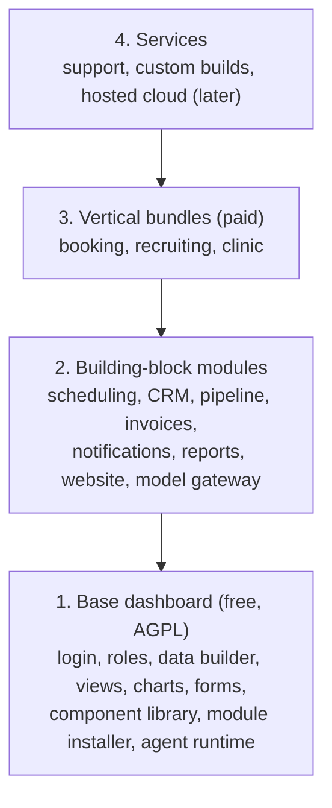
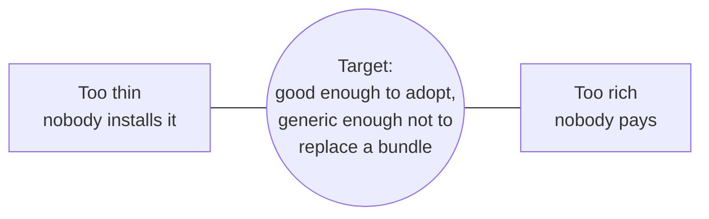
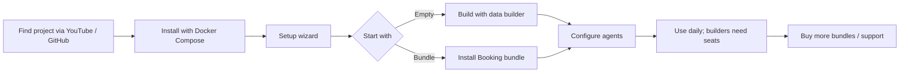

# 02. Product model

Dashground has **four layers**. Only the first is free. Each higher layer is something a business pays for because it saves them weeks of work.

## Layer 1: Base dashboard (free, AGPL-3.0)

Everything required to run an app and to extend it:

- Login, roles, row-level permissions, audit log (basic)
- **Data builder**: collections, fields, relations ([doc 04](04-data-builder.md))
- **Views**: table, form, kanban, calendar, detail, chart ([doc 05](05-views-and-dashboards.md))
- **Dashboards**: drag-and-drop grid of cards, versioned
- Component library
- **Module installer** and drag-and-drop builder ([doc 06](06-modules-and-bundles.md))
- **Builder studio** (proposed): theme (light/dark), form, page, widget and agent builders ([doc 18](18-builder-studio-overview.md))
- **Agent runtime** with bring-your-own model key ([doc 07](07-agents.md))
- **Model gateway** ([doc 08](08-sovereign-ai-and-model-gateway.md))
- Unlimited users

## Layer 2: Building-block modules

Reusable capabilities: scheduling, contacts and CRM, pipeline, invoices, notifications, reports, a website builder, and the model gateway. Many are free, some paid. Bundles are assembled from these, and third parties can publish more.

## Layer 3: Vertical bundles (paid)

A bundle is a **complete solution for one kind of business**:

- A data model
- Screens (views)
- Dashboards
- Workflows
- Pre-configured agents

Installed in one step, then fully editable. A bundle is a starting point, not a locked product.

| Bundle | When | Why this order |
| --- | --- | --- |
| Booking business | First | Simple data model, clear automation targets (reminders, no-shows), easy to demo on camera |
| Recruiting agency | Second | Strong agent use cases (CV screening), and strong sovereignty need (personal data) |
| Clinic / healthcare | Later | Regulated data. Waits for a partner or an audit |

## Layer 4: Services

Support, custom builds and training, quoted per project. A hosted cloud is offered only after the other layers pay for running it.

## Free vs paid capabilities

| Capability | Free base | Paid |
| --- | --- | --- |
| Data builder, tables, forms, kanban, calendar, charts | Yes | |
| Roles, row-level permissions, audit log | Basic | Advanced (SSO, approvals, retention) |
| Module installer and drag-and-drop builder | Yes | |
| Agent runtime with bring-your-own model key | Yes | |
| Prebuilt agents (support, reporting, data entry) | A starter few | Full library |
| Vertical bundles | Demo data only | Licensed per bundle, one-time or yearly |
| Updates and support | Community | Included with a license |
| Hosted cloud | | Later |

## Where the free/paid line sits

**Rule:** revisit the line after the **first ten real installs**.

## Positioning

The lead message is **sovereign AI with custom dashboards**. A company builds the dashboards it needs and runs agents on its own models, on its own servers, with data staying inside its network.

Supporting messages:

- Useful with AI off
- Public models are an option, not the default assumption
- Bundles save weeks of work
- Open source core, no lock-in, data is in plain tables in your own database

## How a customer journey flows

