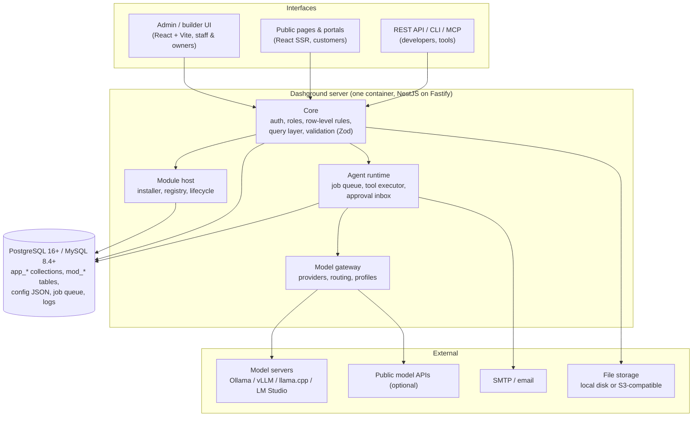
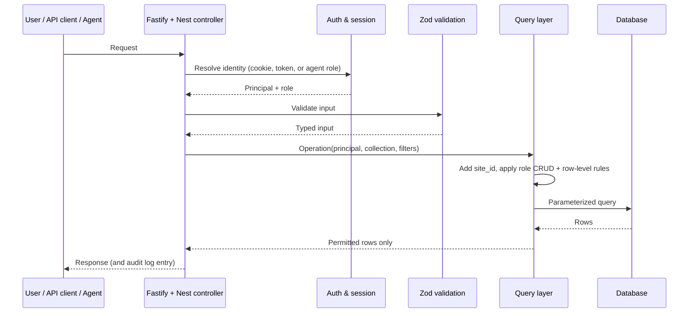
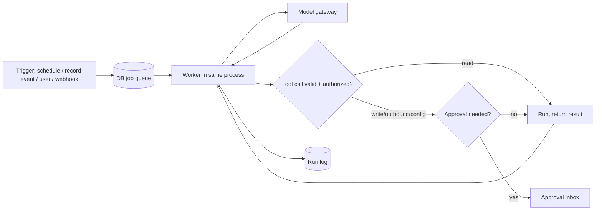
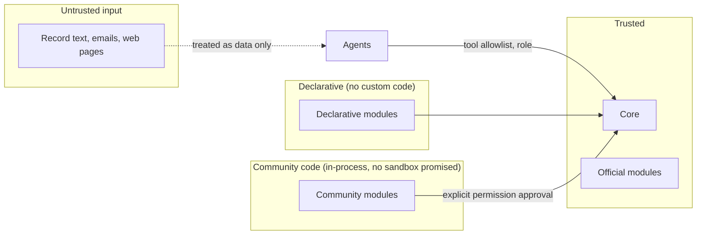

# 03. System architecture

## Goals that shape the architecture

| Goal | Consequence |
| --- | --- |
| One person must be able to build and maintain it | TypeScript end to end, small core, few moving parts |
| Self-hosting must be trivial | One container + one database. No Redis, no separate AI service |
| Users change their own schema at runtime | A data builder with staged migrations |
| Modules install and uninstall without rebuilding | Runtime module loading (spike pending) |
| AI must be governable and sovereign | Agents are data, all model calls pass one gateway |
| One data boundary for everything | Access rules enforced in the query layer |

## Component overview

Three interfaces, three platform parts, four kinds of external service. The source note's architecture figure is summarized here:

> The note describes "3 interfaces, 3 platform parts, 4 external services". The exact grouping in the original figure may differ from the diagram above; reconcile when the figure is exported.

## Request lifecycle

Every request, from any interface, passes through the core. There is no side door to the database.

**Key point:** views, dashboards, the REST API and agents all call the same query layer, so they all see the same data boundary.

## Agent run lifecycle (summary)

Detailed in [doc 07](07-agents.md).

## Process model

- **One Node process** runs HTTP, the module host and the agent workers. Scale-out is possible later by running more instances against the same database; the queue uses `SELECT ... FOR UPDATE SKIP LOCKED`, which is safe for multiple workers.
- **No Redis.** The job queue is a database table. This removes a service from every install.
- **Static admin UI.** The React/Vite UI compiles to static assets served by the same server, on the same port, with the same version number.
- **Public pages** are server-rendered React, only for the website module and customer portals.

## Data stores

| Store | What lives there |
| --- | --- |
| Database tables `app_<collection>` | User-defined collections |
| Database tables `mod_<name>_*` | Module-owned tables |
| Database JSON columns | Views, dashboards, workflows, agent definitions (validated by Zod) |
| Database tables | Job queue, run logs, audit log, approval inbox, module registry, license state |
| File storage | Uploads, on local disk or S3-compatible, never inside the web root |

## Boundaries and who may cross them

## Decisions and reasons

| Decision | Reason |
| --- | --- |
| Single process, single container | Lowest install friction for non-expert operators |
| Database-backed queue | Avoids Redis; transactional with application data |
| Agents run in-process | No separate AI service to host or secure |
| Agents reach models only via gateway | One place to enforce tag routing, concurrency, logging, air-gap |
| Query layer owns access rules | Cannot be forgotten per-feature; testable in one place |
| Modules ship prebuilt, graceful restart on install | Simpler and safer than hot-loading code in v1 |
