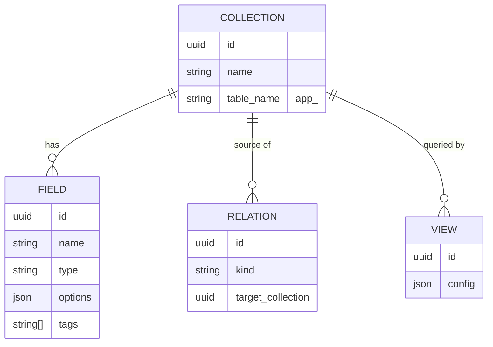
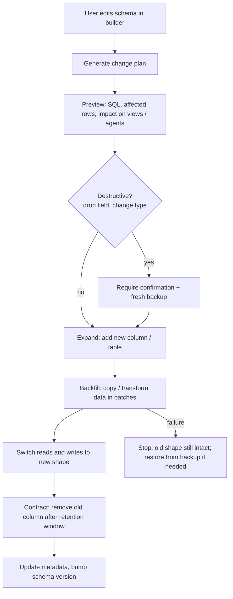

# 04. Data builder

The data builder is **the hardest part of the core**. Users change their own schema while the app is running, and everything else (views, dashboards, workflows, agents) reads what the builder defines.

## What users can do

Define **collections**, **fields** and **relations** in the admin UI.

### Field types (version 1)

| Type | Notes |
| --- | --- |
| text | Short and long variants |
| number | Integer and decimal |
| money | Amount + currency, stored without float error |
| date and time | Stored in UTC, shown in the user's zone |
| boolean | |
| select | Single choice from defined options |
| multi-select | Multiple choices |
| relation | One-to-many, many-to-one, many-to-many via join table |
| file | Reference to file storage |
| JSON | Free-form structured data |

Fields can also carry **tags** (for example `personal-data`) used by the model gateway for routing ([doc 08](08-sovereign-ai-and-model-gateway.md)).

## Storage design

- Each collection is a **real table** in the user's database, named `app_<collection>`. Reporting tools, backups and BI connections therefore work normally.
- Module tables use `mod_<name>_` so they never collide with user collections.
- Every table has:

| Column | Purpose |
| --- | --- |
| `id` | UUID or ULID (portable across both databases) |
| `site_id` | Tenancy / data boundary, applied in the query layer |
| `created_at`, `updated_at` | Timestamps |
| `deleted_at` | Soft delete. Deleting soft-deletes by default |

- Collection and field definitions themselves are stored as metadata that the query layer and UI read.

## Schema changes: the staged approach

MySQL commits DDL implicitly, so a failed migration cannot simply roll back. Both databases therefore use the same **expand, backfill, contract** pattern.

### Examples

| Change | Plan |
| --- | --- |
| Add a field | Expand only. Nullable column, default applied |
| Rename a field | Expand new column, backfill, switch, contract old one |
| Change a type | Expand, backfill with conversion, report rows that failed to convert, confirm, contract |
| Drop a field | Soft-hide first. Physical drop only after confirmation and backup |
| Add a relation | Add foreign key column or join table; validate existing data |

## Dependency awareness

Before applying a change the builder checks what depends on the field: views, dashboards, workflows, agent definitions, API tokens. The preview lists them. Agents that propose configuration changes go through the same checks ([doc 07](07-agents.md)).

## Database portability rules

- Common SQL subset, UUID/ULID keys
- Lowercase slugs and emails (MySQL comparisons are case-insensitive by default)
- `utf8mb4` on MySQL
- JSON columns for configuration
- Details in [doc 11](11-tech-stack-and-database.md)

## Risks and tests

| Risk | Control |
| --- | --- |
| Schema change on live data corrupts rows | Staged changes, backup first, batch backfill with verification |
| MySQL cannot roll back DDL | Never rely on transactional DDL; each stage is independently safe |
| Behaviour differs between databases | Every migration test runs on PostgreSQL and MySQL in CI |
| User drops something agents rely on | Dependency check in preview |

## Open spike

Kysely vs Drizzle, including staged schema changes on both databases. One week. See [doc 16](16-risks-and-open-decisions.md).
