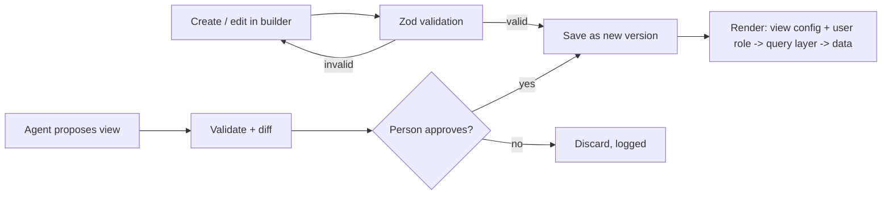
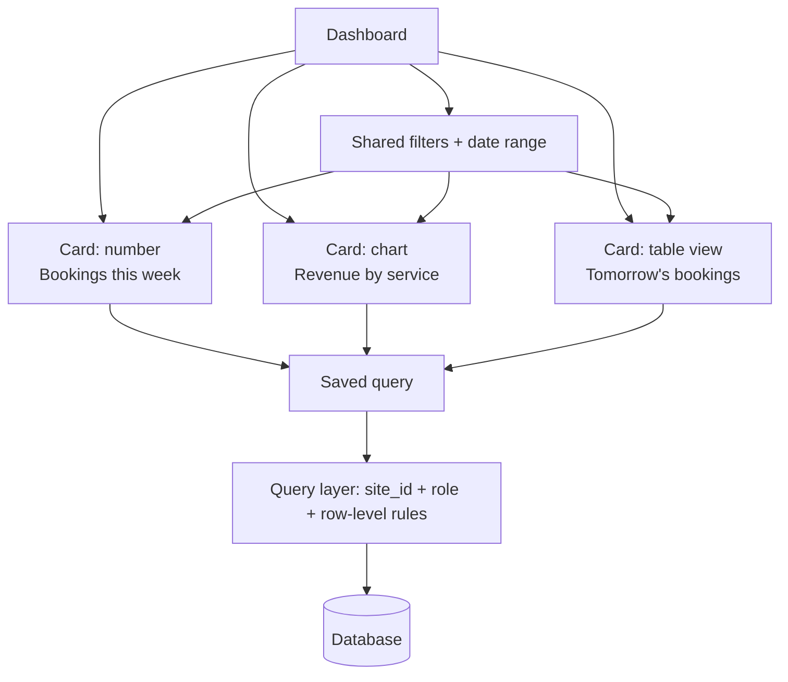
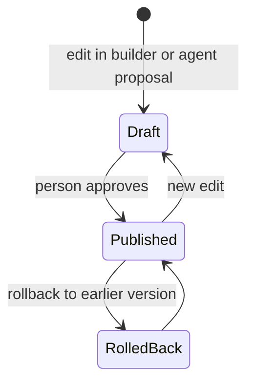
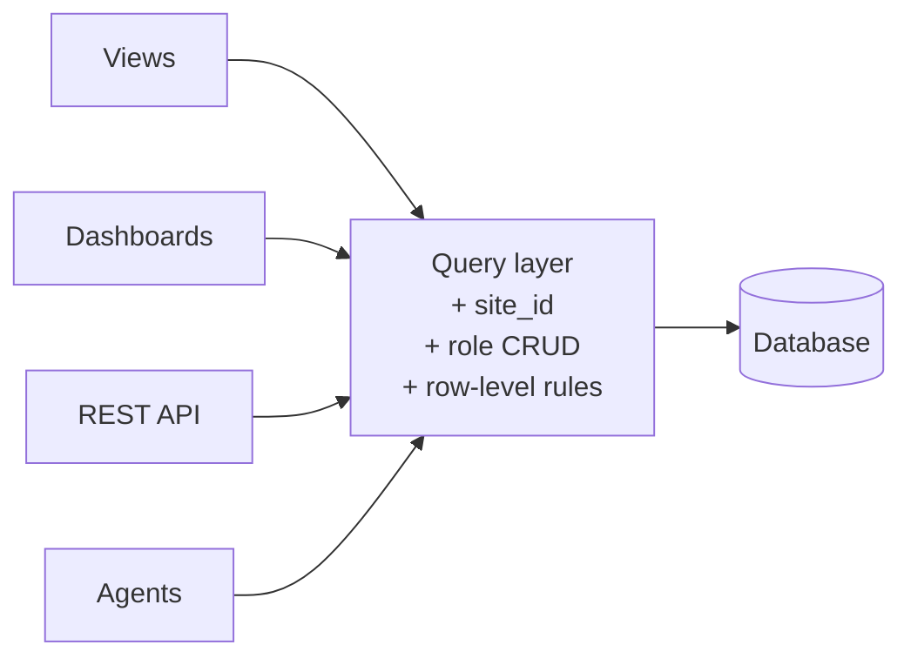

# 05. Views, dashboards and access

## Views

A **view** is saved configuration: collection, filters, sort, columns, permissions. It is stored as JSON and validated by a Zod schema. Because a view is plain validated data, **agents can propose new views safely**: the proposal is checked against the same schema and approved as a diff.

| View | Use |
| --- | --- |
| Table | Sort, filter, group, inline edit, bulk actions |
| Form | Create and edit, with conditional fields and validation |
| Kanban | Move records between statuses |
| Calendar | Bookings, interviews, appointments |
| Detail | One record with related lists and activity |
| Chart | Bar, line, pie and number cards computed from a query |

### Example view configuration (illustrative)

```json
{
  "id": "view_bookings_calendar",
  "type": "calendar",
  "collection": "booking",
  "filters": [{ "field": "status", "op": "ne", "value": "cancelled" }],
  "sort": [{ "field": "starts_at", "dir": "asc" }],
  "options": { "start": "starts_at", "end": "ends_at", "title": "customer.name" },
  "permissions": { "roles": ["owner", "staff"] }
}
```

The exact schema is defined in code by Zod and exported as JSON Schema, so the builder UI, API docs (OpenAPI) and agent tools share one definition.

### View lifecycle



## Dashboards

A **dashboard** is a drag-and-drop grid of cards.

- Each card is a **view**, a **chart** or a **number**, bound to a saved query.
- A **date range and filters are shared** across the dashboard.
- Dashboards are **versioned**, so changes can be reviewed and rolled back.



### Versioning flow



## Access control

### Roles

Roles grant **create, read, update, delete** per collection.

### Row-level rules

Conditions added to a role, for example *"only records assigned to me"*:

```json
{ "collection": "booking", "role": "staff", "read": { "assigned_to": "$currentUser.id" } }
```

### Enforcement

The **query layer applies these rules on every read** (and checks them on writes). Because views, dashboards, the API and agents all use the query layer, there is a single data boundary.



### What is free vs paid

| Feature | Free | Paid |
| --- | --- | --- |
| Roles, row-level rules, audit log | Basic | |
| SSO, approvals, retention rules | | Advanced (builder seats) |

## UI building blocks

- Component library shared by views and dashboards
- Drag-and-drop grid for dashboards
- View builder
- **Open spike:** build on an existing grid/builder library or write our own (one week). See [doc 16](16-risks-and-open-decisions.md).

## Tests that matter

- Row-level rules cannot be bypassed via a view, a dashboard card, a saved query, the API or an agent tool.
- Cross-`site_id` access is impossible.
- Invalid or hostile view JSON is rejected by Zod, not rendered.
