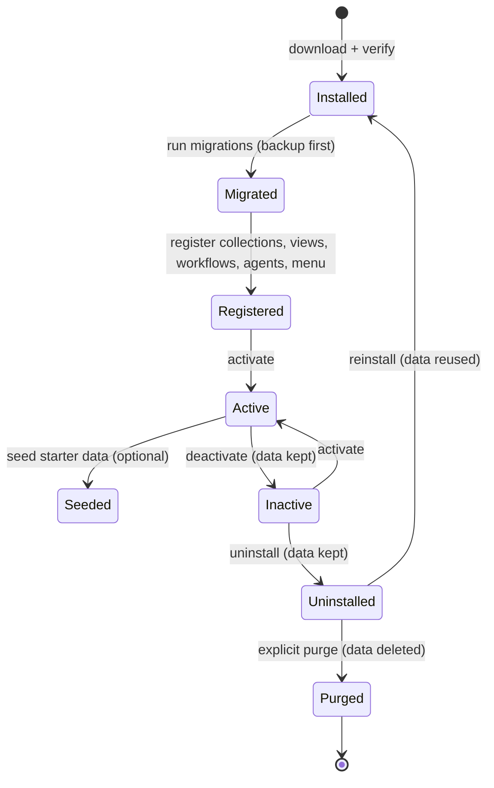
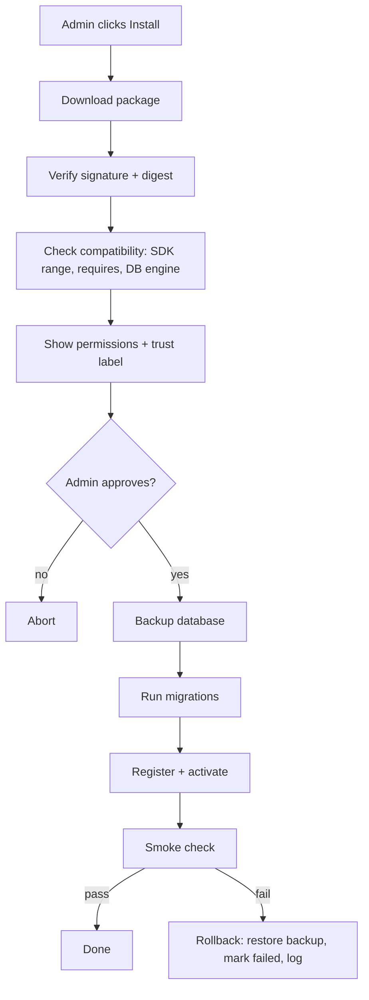
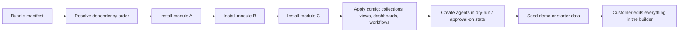

# 06. Modules and vertical bundles

A **module** adds a capability. A **bundle** is a set of modules plus configuration and agents that make a complete solution. Both install and uninstall from the admin UI **without rebuilding the product**.

## Module definition

```ts
import { defineModule } from '@dashground/sdk';

export default defineModule({
  id: 'dashground/scheduling',
  version: '1.0.0',
  sdk: '^1.0',
  requires: ['dashground/contacts'],
  permissions: ['scheduling.read', 'scheduling.write'],
  migrations: './migrations',
  collections: ['./collections/booking', './collections/service'],
  views: ['./views/calendar', './views/booking-form'],
  workflows: ['./workflows/confirm-booking'],
  agents: ['./agents/reminder'],
  admin: { menu: [{ label: 'Bookings', path: '/bookings' }] },
});
```

| Field | Meaning |
| --- | --- |
| `id`, `version` | Scoped identity and semver |
| `sdk` | Compatible SDK range. Checked at install |
| `requires` | Other modules. Used for dependency ordering |
| `permissions` | What the module asks for. Shown to the admin before install |
| `migrations` | Module-owned schema changes (tables prefixed `mod_<name>_`) |
| `collections`, `views`, `workflows`, `agents` | Declarative contributions |
| `admin.menu` | Entries added to the admin navigation |

## Lifecycle

**Install, migrate, register, activate, seed.** Deactivate keeps data. Uninstall keeps data. **Purge** is a separate, explicit step.



### Install pipeline



Modules ship **prebuilt**. The first version applies migrations with a **graceful restart** rather than hot-loading code.

## Trust tiers

| Tier | What it is | Code runs in server? |
| --- | --- | --- |
| Official | Built and signed by the project | Yes |
| Declarative | Collections, views, workflows and agents only. No custom code | No custom code |
| Community code | Third-party, including AI-assisted modules | Yes, in-process, **no sandbox promised** |

**Declarative modules are the default path.** They can be validated completely at install time. Code modules are allowed for developers, labelled clearly, and need explicit permission approval.

## Bundles

A bundle is a **manifest** that lists:

- Modules with versions
- A seed data set
- Dashboards
- Workflows
- Agent definitions



Agents installed by a bundle start with **approvals on** and can be run in **dry-run** first ([doc 07](07-agents.md)).

### Planned bundles

| Bundle | Modules (indicative) | Agents (indicative) |
| --- | --- | --- |
| **Booking** | contacts, scheduling, notifications, invoices (basic), reports | Booking reminder, no-show follow-up, "answer" agent over bookings |
| **Recruiting** | contacts, pipeline, notifications, reports | CV screening to draft shortlist, candidate follow-up |
| **Clinic** (later) | contacts, scheduling, notifications | Waits for partner or audit |

## Developer experience

- `@dashground/sdk` provides `defineModule`, `defineAgent`, field and view helpers
- A **CLI** scaffolds and validates modules
- An **MCP server** lets Cursor, Claude Code or Codex read the schema and docs, scaffold, validate and propose configuration diffs ([doc 09](09-integrations.md))
- Those tools have no production data access unless the owner grants a scoped token

## Open spike

**Install and remove a module at runtime on NestJS.** If it fails, fall back to Next.js and a rebuild step. Result decides whether install is instant or a rebuild.
