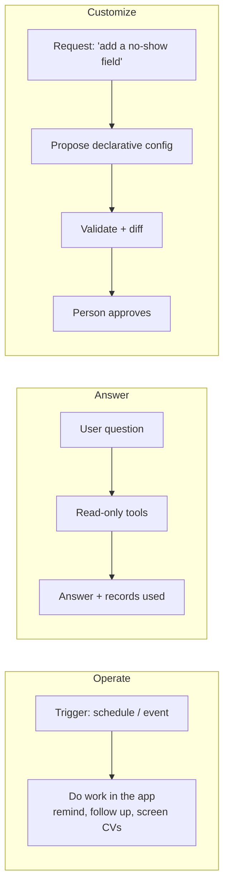
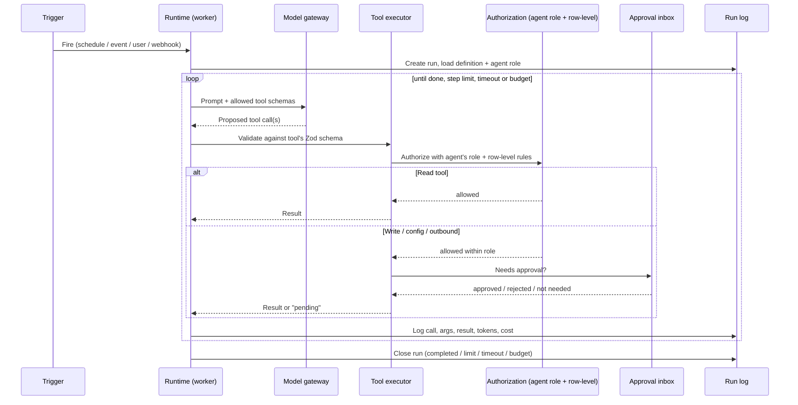
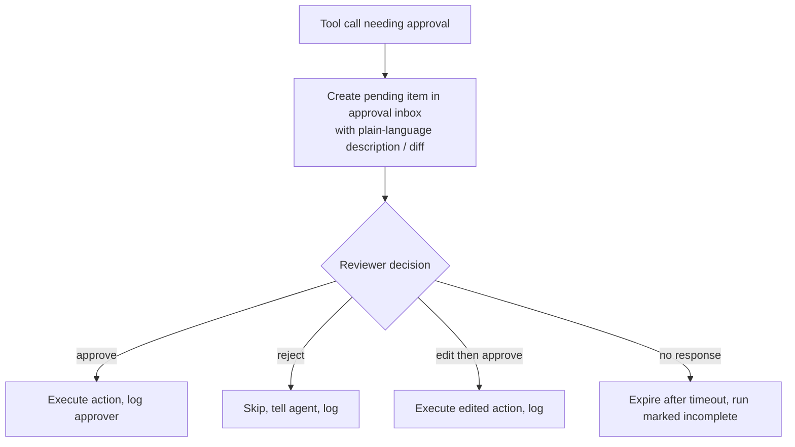
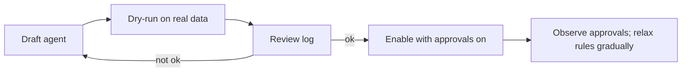

# 07. Agent system

## Why agents, not AI-written modules

Customers customize their app by **configuring agents**, not by running code an AI wrote. An agent is a configured worker inside the platform: instructions, a model, a list of allowed tools, triggers, a budget and approval rules. It acts only through the platform's own actions.

This fixes the weakness of the earlier plan. Generated code is untrusted, needs review, breaks on upgrades and is hard to support. An agent is **data**: it can be inspected, permissioned, logged, paused and upgraded with the platform.

|  | AI-written module | Agent |
| --- | --- | --- |
| What it produces | New code installed into the product | Actions on data and configuration, through platform tools |
| Trust risk | Runs in the server process with the module's permissions | Limited to its tool list, checked on every call |
| Platform upgrades | Can break when the SDK changes | Keeps working while tools stay compatible |
| Review | Someone must read the code | Someone approves a plain-language action or config diff |
| Audit | Code history | Every run, tool call and approval is logged |
| Best for | Developers extending the platform | Business owners and staff running their app |

## Three jobs an agent does



1. **Operate**: work inside the app on a trigger or schedule (booking reminders, no-show follow-ups, CV screening into a draft shortlist).
2. **Answer**: respond to questions over the user's own data ("which clients cancelled twice this month"), read-only, showing the records used.
3. **Customize**: propose changes as **declarative configuration** (a field, a view, a dashboard, a workflow). Validated against schemas, shown as a diff, approved by a person. The result is configuration, never executable code.

## Agent definition

```ts
defineAgent({
  id: 'scheduling/reminder',
  name: 'Booking reminder',
  instructions: 'Remind customers of bookings 24 hours ahead. Be brief and polite. Never promise refunds.',
  model: { tier: 'small' },
  tools: ['bookings.list', 'contacts.get', 'email.send'],
  triggers: [{ schedule: '0 * * * *' }],
  approval: { 'email.send': 'required' },
  budget: { monthlyUsd: 5, maxStepsPerRun: 8 },
});
```

| Property | Purpose |
| --- | --- |
| `instructions` | Plain-language behaviour and limits |
| `model` | A **capability tier**, not a vendor. Owner maps it to a provider |
| `tools` | Allowlist. The agent can call nothing else |
| `triggers` | Schedule, record event, user request, incoming webhook |
| `approval` | Per-tool rule, e.g. `required` |
| `budget` | Monthly spend cap and max steps per run |

Agents are stored as validated JSON/data, so they can be listed, diffed, exported and bundled.

## Runtime



1. A trigger fires.
2. The runtime creates a run, loads the definition and the agent's own role.
3. The model, via the gateway, proposes tool calls.
4. Each call is validated against the tool's Zod schema, then authorized against role and row-level rules.
5. Read tools return results. Write, config and outbound tools run or wait in the approval inbox.
6. The run ends on completion, step limit, timeout or budget. All of it is logged.

## Tool categories

The platform ships the tools; modules add their own. An agent gets only the tools in its definition.

| Category | Examples | Default rule |
| --- | --- | --- |
| Read | list, get, search, aggregate | Allowed within the agent's role |
| Write | create or update a record | Allowed within the role; approval can be required |
| Configuration | propose a field, view, dashboard or workflow | Always a diff that a person approves |
| Outbound | send email, SMS or webhook | Approval required until the owner relaxes it |
| Administration | users, roles, keys, licenses | **Never available to agents** |

## Approval flow



## Identity and limits

- Each agent has its **own least-privilege role**. It never inherits the permissions of the person who created or triggered it.
- **No raw SQL tool.** The tool list is an allowlist.
- Retrieved text (records, emails, web pages) is **untrusted data**. It cannot add tools, change instructions or raise permissions.

## Cost control

- Step limit per run, monthly budget per agent
- Global **owner kill switch**
- Usage and cost logged per agent
- Provider keys encrypted at rest (with `APP_SECRET`) and supplied by the owner, so the **project carries no AI bill**
- Local-model runs cost nothing and are not metered

## Testing agents

**Dry-run mode:** write and outbound tools are *recorded but not executed*. A person reviews the log before enabling. Each official agent also ships an **eval suite** (see [doc 08](08-sovereign-ai-and-model-gateway.md)) covering normal tasks, injection attempts, budget exhaustion and tool misuse.



## External AI tools and MCP

The platform exposes an **MCP server and CLI** for Cursor, Claude Code and Codex: read schema/docs, scaffold and validate modules, propose configuration diffs. No production data without a scoped token from the owner. **Agents can use external MCP tools only after an administrator approves each one.** See [doc 09](09-integrations.md).

## Agent packs

Prebuilt agents with tested instructions. A starter few are free; the full library is paid (builder seats). Packs declare the minimum model capabilities they need, and the platform refuses to enable them on models that fall short.
