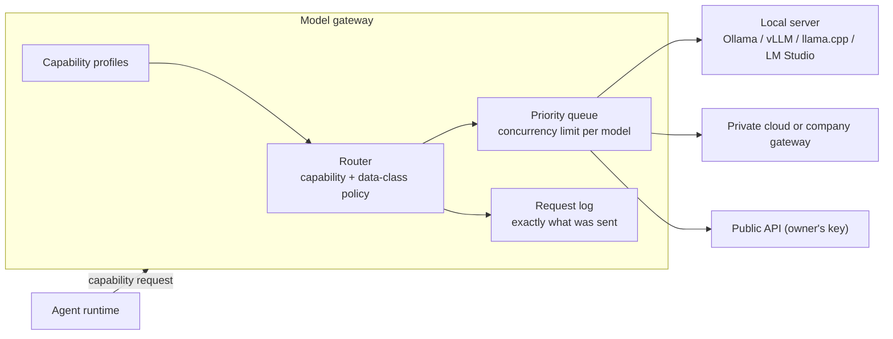
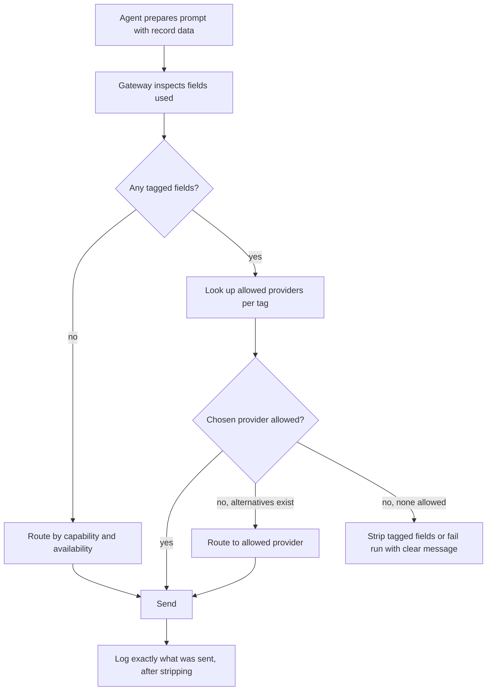
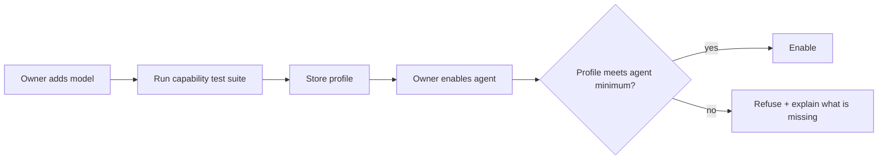
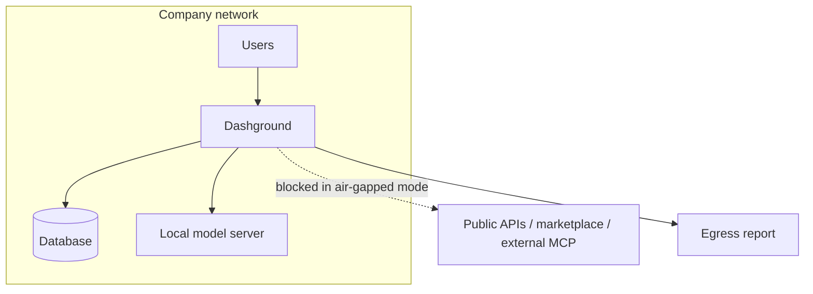

# 08. Sovereign AI and the model gateway

**Sovereign AI is the main reason to choose Dashground.** A company runs its dashboards, its data and its models on infrastructure it controls, and nothing has to leave its network. Public models remain an option, not the default assumption.

## The model gateway

All model calls from agents and the platform go through one gateway. It treats *where the model runs* as configuration.

### Provider types

| Type | Examples | Typical use |
| --- | --- | --- |
| Local server (OpenAI-compatible) | Ollama, vLLM, llama.cpp server, LM Studio | Sovereign installs; **default in the setup wizard** |
| Private cloud or company gateway | A model in the company's own cloud account or behind its own proxy | Companies without GPUs on site |
| Public API | A provider the owner picks, with the owner's own key | Hardest jobs, or owners who accept cloud processing |

An agent states the **capability it needs, not a vendor**, so the owner can move it between providers without editing it.

## Data-class routing

Fields can be **tagged** (for example `personal-data`). Tagged fields go only to the providers the owner allowed for that tag. A policy like *"records with personal data use local models only"* is enforced by the gateway, not left to each agent.

## Capability profiles

Each configured model gets a **profile after a test**:

| Property | Why |
| --- | --- |
| Tool calling | Agents depend on it |
| Structured output | Needed for schema-constrained output |
| Context length | Limits how much data an agent can see |
| Speed | Decides interactive vs background suitability |
| Official agents passed | Which agent evals the model passed |

Agents and packs declare **minimum requirements**. The platform refuses to enable an agent on a model that falls short, with a clear message.

## Making smaller models reliable

- Schema-constrained output where the server supports it
- Few tools per agent
- Short steps rather than long plans
- Approvals on by default
- Agent **eval suite** must pass before enabling
- The free-form **customization agent** is only enabled on models that pass its eval. Other models get **guided templates**

## Capacity management

A single GPU serves few requests at once.

- **Concurrency limit per model**
- **Priority queue**: interactive requests before scheduled runs
- Long timeouts and streaming
- Agent runs stay **asynchronous**

## Sovereign controls

| Control | What it does |
| --- | --- |
| **Air-gapped mode** | Blocks all outbound connections except those the owner allows. Disables public providers, external MCP tools and marketplace fetch. Updates come as offline bundles |
| **Egress report** | Lists every outside destination contacted in the last 30 days |
| **Run log transparency** | Shows exactly what was sent to a model, after tag rules removed fields |
| **Retention** | Prompts and run logs stay in the owner's database and follow its retention settings |

## What the platform does not do

- It **does not ship or download models**
- It **does not promise parity** with public models
- Tested-model lists and minimum hardware guidance come from the **local-model spike**
- It stays fully useful with **AI switched off**

## Spike

Run three or four local models of different sizes through Ollama on the booking reminder agent, testing tool calling and structured output, to set the capability profile format. See [doc 16](16-risks-and-open-decisions.md).
