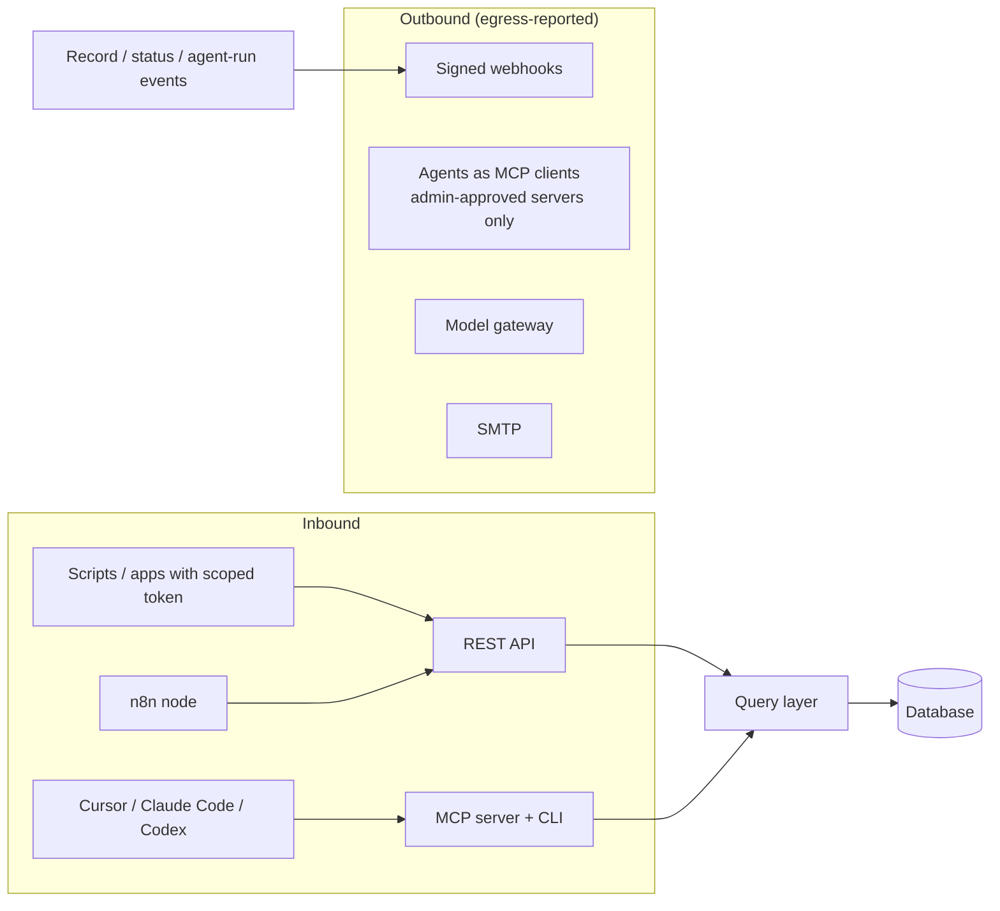
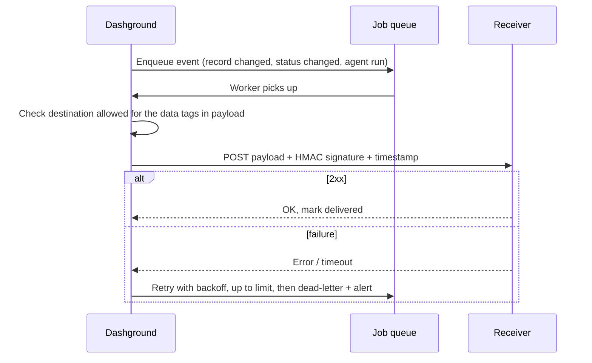

# 09. Integrations

Most tools connect through a few **shared interfaces**, so there is little custom work per tool, and every integration shows up in the egress report.

## Interfaces

| Interface | What it gives | Phase |
| --- | --- | --- |
| REST API with scoped tokens | Read and write collections and run actions; every call follows roles and row-level rules | 2 |
| OpenAPI spec | Generated from the Zod schemas, so docs and client libraries stay in sync | 2 |
| Outbound webhooks | Signed, retried events on record changes, status changes and agent runs | 2 |
| n8n node | Triggers and actions in n8n, which can itself be self-hosted | 4 |
| MCP server and client | The platform as an MCP server for external AI tools; agents as clients of approved MCP servers | 4 |
| Model servers | Ollama, vLLM, llama.cpp server, LM Studio and public APIs through the model gateway | 4 |
| Zapier app | Optional; reaches only installs open to the internet, so off in air-gapped mode | On demand |

## REST API and tokens

- Scoped tokens: choose collections, operations and optionally a role
- Every call passes the query layer, so roles and row-level rules apply
- OpenAPI generated from Zod: docs and client libraries cannot drift

## Outbound webhooks

Receivers verify the signature and timestamp to reject forgeries and replays.

## MCP

- **Server side:** lets external AI tools read schema and docs, scaffold and validate modules, and propose configuration diffs. No production data unless the owner grants a scoped token.
- **Client side:** agents can call external MCP tools only after an **administrator approves each tool**.

## n8n

An n8n node provides triggers and actions. Agents can also start an n8n workflow or call a webhook through an **outbound tool**, under the same approval rules as sending email.

## Rules

1. Every integration **declares what data it sends and where**.
2. Tagged fields reach a webhook or connector **only if the owner allowed that destination for that tag**.
3. Air-gapped mode disables every outbound integration not explicitly allowed.
4. Agents calling webhooks or n8n obey outbound-tool approval rules.
5. Connectors ship as **marketplace modules** with declared permissions and destinations, so the project is not the only maintainer.
