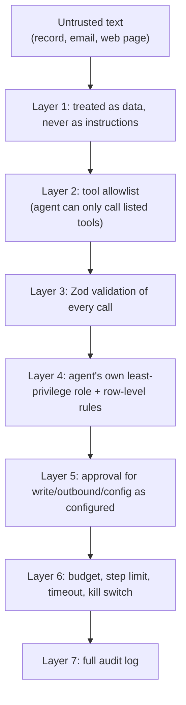
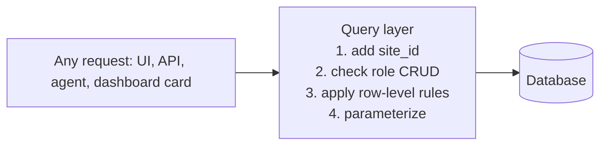
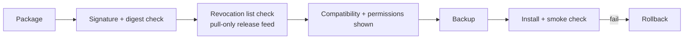

# 10. Security model

Business apps hold customer, candidate and payment-adjacent data. **Security is a product feature and a release gate.**

## Threat and control map

| Area | Risk | Control |
| --- | --- | --- |
| Agents | Prompt injection from record text, emails or web pages | Treat all retrieved text as untrusted data; it cannot add tools, change instructions or raise permissions |
| Agents | Runaway cost or loops | Step limits, monthly budgets, timeouts, owner kill switch |
| Agents | Wrong or harmful action | Approval for outbound and configuration tools, dry-run mode, per-run audit log |
| Agents | Over-broad access | Own least-privilege role, tool allowlist, row-level rules, no raw SQL, no administration tools |
| Modules | Malicious or broken code | Trust tiers, permission prompts, signed packages, declarative-first, install smoke check, rollback |
| Supply chain | Tampered package or dependency | Signed releases, digests, lockfiles, revocation list in the release feed, dependency scanning in CI |
| Accounts | Takeover | Argon2id, secure cookie sessions, optional TOTP, rate limits, session list and revoke |
| Data | Cross-site or cross-role leakage | `site_id` on every query, row-level rules in the query layer, tests that try to break them |
| Web app | XSS, CSRF, injection | Output escaping, CSRF tokens, Zod validation on every input, parameterized queries, strict headers |
| Files | Unsafe uploads | Type and size checks, storage outside the web root, no execution |
| Privacy | Personal data in prompts | Send the minimum fields to a model, show what was sent in the run log, owner choice of provider |
| Operations | Lost data | Backup before every migration or module install, tested restore, documented upgrade path |

## Defence in depth for agents

An injected instruction that tries to "email all customers" still needs the email tool in the allowlist, a role permitted to read those contacts, and a human approval. Each layer is independent.

## Data boundary

Access rules live in **one place**, not in each feature, so there is nothing to forget.

## Authentication and sessions

- Passwords hashed with **Argon2id**
- **Secure cookie sessions** (HttpOnly, Secure, SameSite)
- Optional **TOTP**
- **Rate limits** on login and sensitive endpoints
- Session list with revoke

## Module and supply-chain security

CI includes dependency scanning and lockfiles. Releases are signed.

## Release gates

No release ships unless:

1. Tests that try to **cross role and site boundaries pass on both databases**
2. The **dependency scan is clean**
3. The **agent suite** passes: injection attempts, budget exhaustion, tool misuse

An **independent security review** happens before 1.0.

## Regulated data

The platform gives **no compliance promise** by itself. A healthcare bundle waits for a partner or an audit. The docs state plainly what the software does and does not cover.

## Sovereign deployments

With local models and air-gapped mode, no customer data has to leave the network, and the egress report lets the owner verify it. This helps with data-residency and privacy requirements but **does not replace a compliance review**.

## Vulnerability reporting

`SECURITY.md` and a private reporting address are published **at launch**, with a stated acknowledgement target.

## Test checklist (to be turned into automated suites)

- [ ] User A cannot read site B's rows via any interface
- [ ] Row-level rule holds in table view, chart card, API, agent tool
- [ ] Prompt-injection corpus cannot add tools or escalate role
- [ ] Budget exhaustion stops a run at the limit
- [ ] Agent cannot call administration tools
- [ ] Tampered module package is rejected
- [ ] Revoked module is flagged/disabled
- [ ] Upload with executable type is rejected or stored inert
- [ ] CSRF token required on state-changing requests
- [ ] Air-gapped mode blocks undeclared egress
- [ ] With the REST API switched off, `/api` and its docs return 404 and tokens are rejected ([doc 26](26-rest-api-and-mobile-access.md))
- [ ] A client app cannot reach collections or fields the owner did not expose, and exposure never widens a user's role
- [ ] Reused refresh tokens revoke the whole token family
