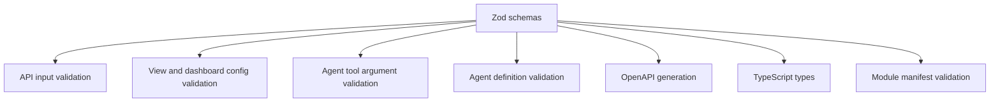
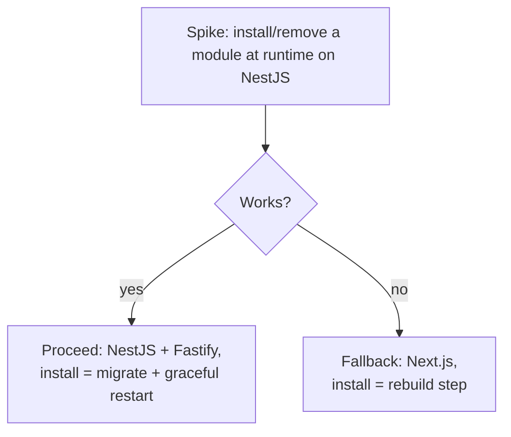
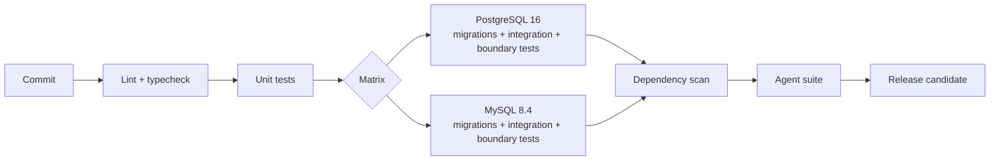

# 11. Tech stack and database strategy

TypeScript end to end, chosen so **one person can build and maintain it** and so **modules install without rebuilding the product**.

## Stack

| Concern | Choice | Why |
| --- | --- | --- |
| Server | NestJS on Fastify | Nest modules map naturally to platform modules; strong typing; Fastify is fast |
| Admin and builder UI | React and Vite | Compiled to static assets served by the same server |
| Public pages and portals | React server rendering | Only for the website module and customer portals |
| Query layer | Kysely (Drizzle as alternative) | Typed SQL builder without heavy ORM magic. One-week spike decides |
| Validation | Zod | One schema shared by API, views, tools and agent definitions |
| Auth | Argon2id and cookie sessions | Optional TOTP |
| Jobs and agent runs | Database-backed queue (`SKIP LOCKED`) | No Redis required |
| Files | Local disk or S3-compatible | Chosen in the setup wizard |
| Email | SMTP | Provider presets |
| Packaging | pnpm and Turborepo monorepo | One published package |

## Why Zod is the backbone



One definition, many consumers: they cannot drift apart.

## Why not Next.js

Next.js bundles code at **build time**, which conflicts with installing and removing modules from the UI. If the one-week runtime-module spike fails, Next.js is the fallback and the install flow becomes a rebuild step.



## Why a database-backed queue

- No Redis in every install
- Job rows are transactional with the data they relate to
- `SELECT ... FOR UPDATE SKIP LOCKED` (PostgreSQL 9.5+, MySQL 8.0+) lets several workers pull jobs safely
- Trade-off: lower raw throughput than Redis. Acceptable for small and medium business workloads

## Databases

**PostgreSQL 16+ is the reference. MySQL 8.4+ is supported. Both run in CI from the first commit.**

| Rule | Reason |
| --- | --- |
| Common SQL subset, UUID/ULID keys | Portability |
| Config (views, dashboards, agents) in JSON columns | Flexible, schema-validated at the app layer |
| Lowercase slugs and emails | MySQL comparisons are case-insensitive by default |
| `utf8mb4` on MySQL | Full Unicode, including emoji |
| Migrations as expand, backfill, contract | MySQL commits DDL implicitly |
| Module tables `mod_<name>_`, user collections `app_` | Namespacing |
| `site_id` and row-level rules in the query layer | One enforcement point |

### CI matrix



## Monorepo layout (proposed)

```
dashground/
  apps/
    server/          NestJS + Fastify
    admin/           React + Vite admin and builder UI
    portal/          React SSR (website module, customer portals)
  packages/
    sdk/             @dashground/sdk  defineModule, defineAgent, helpers
    schemas/         Zod schemas shared everywhere
    query/           Query layer (site_id, roles, row-level rules)
    gateway/         Model gateway
    agents/          Agent runtime and tool registry
    cli/             create-dashground, module tooling
    mcp/             MCP server
  modules/           Official modules
  bundles/           Vertical bundles
  docs/
```

## Single package

Server and admin UI ship as **one package, one port, one version number**. Users install and upgrade a single thing.
