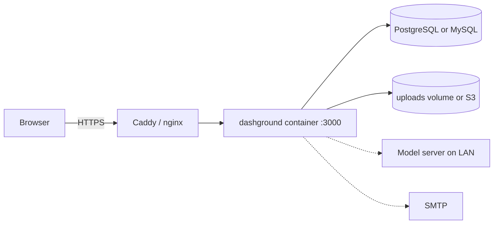
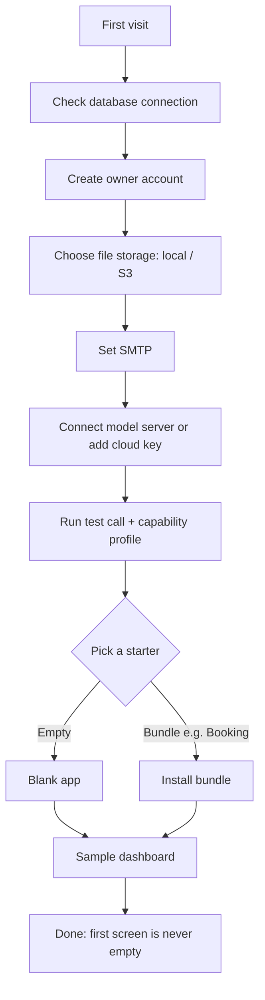
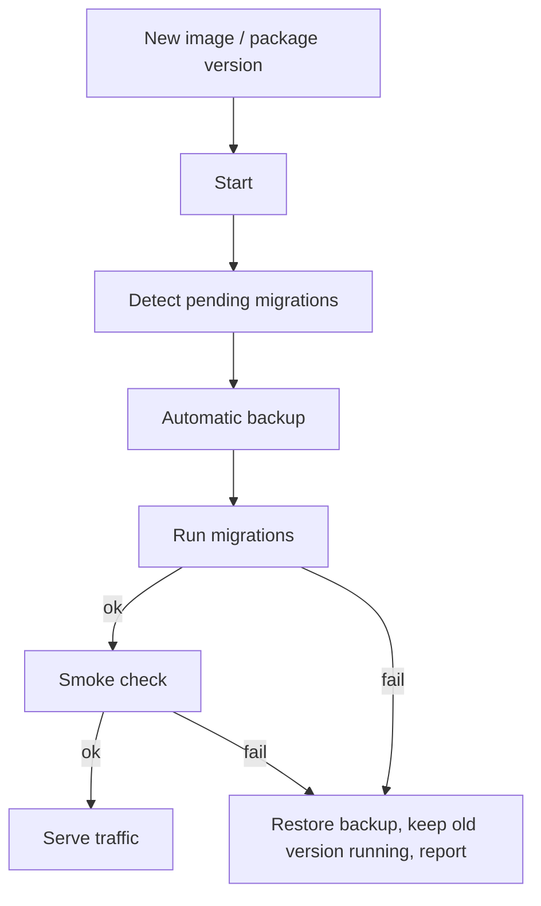

# 12. Setup and deployment

The server and admin UI ship as one package, on one port, with one version number. Three install paths cover most users.

## Install paths

### 1. Docker Compose (recommended)

```yaml
services:
  app:
    image: dashground/dashground:latest
    ports: ['3000:3000']
    environment:
      DATABASE_URL: postgres://dashground:change-me@db:5432/dashground
      APP_SECRET: change-me-to-a-long-random-string
      APP_URL: https://dashboard.example.com
    volumes:
      - uploads:/app/uploads
    depends_on: [db]
  db:
    image: postgres:16
    environment:
      POSTGRES_USER: dashground
      POSTGRES_PASSWORD: change-me
      POSTGRES_DB: dashground
    volumes:
      - pgdata:/var/lib/postgresql/data
volumes:
  uploads:
  pgdata:
```

Run `docker compose up -d`, then open the app in a browser. For MySQL, swap the `db` service for `mysql:8.4` and use a `mysql://` URL.

### 2. Installer command (no Docker)

```bash
npx create-dashground my-dashboard
cd my-dashboard
npm run start
```

### 3. From source (contributors)

```bash
git clone https://github.com/<org>/dashground.git
cd dashground
pnpm install
pnpm dev
```

## Topology



## Setup wizard

The first visit runs a wizard.



The model step defaults to a **local server**, matching the sovereign positioning. The AI step can be skipped.

## Environment variables

| Variable | Purpose |
| --- | --- |
| `DATABASE_URL` | PostgreSQL or MySQL connection string |
| `APP_SECRET` | Signs sessions and encrypts stored provider keys |
| `APP_URL` | Public URL, used in emails and links |
| `STORAGE_DRIVER` | `local` or `s3` |
| `SMTP_URL` | Outgoing email |
| `LICENSE_KEY` | Optional; unlocks paid bundles offline |

`APP_SECRET` loss means stored provider keys cannot be decrypted. Document it in the backup guide.

## Production basics

- Put the app behind HTTPS with Caddy or nginx
- Back up the database **and** the uploads volume nightly
- **Test a restore before launch**

## Upgrades

Upgrades are a version bump: the app takes a backup, runs migrations and restarts. **A failed migration rolls back to the backup.**



## Air-gapped installs

- Updates delivered as **offline bundles**
- Yearly license keys (monthly keys need a pull from the admin screen)
- Public providers, external MCP tools and marketplace fetch disabled
- Egress report to verify

## Backups

| What | How | Frequency |
| --- | --- | --- |
| Database | `pg_dump` / `mysqldump` or volume snapshot | Nightly, plus automatic before migrations and module installs |
| Uploads | Volume snapshot or S3 versioning | Nightly |
| `APP_SECRET` | Stored separately from backups | Once, on change |
