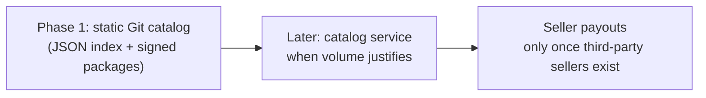
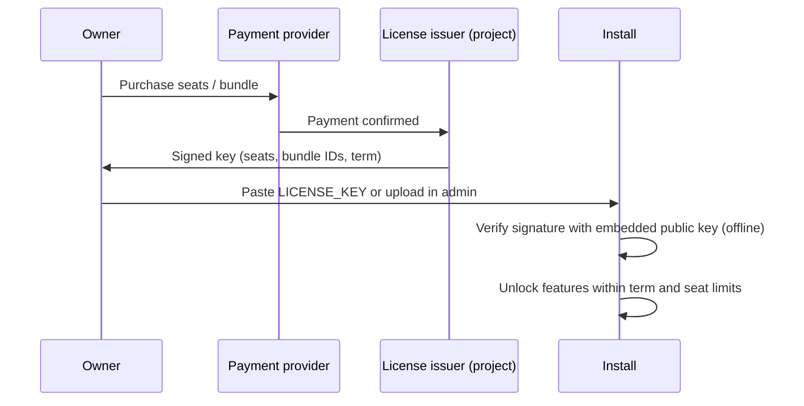
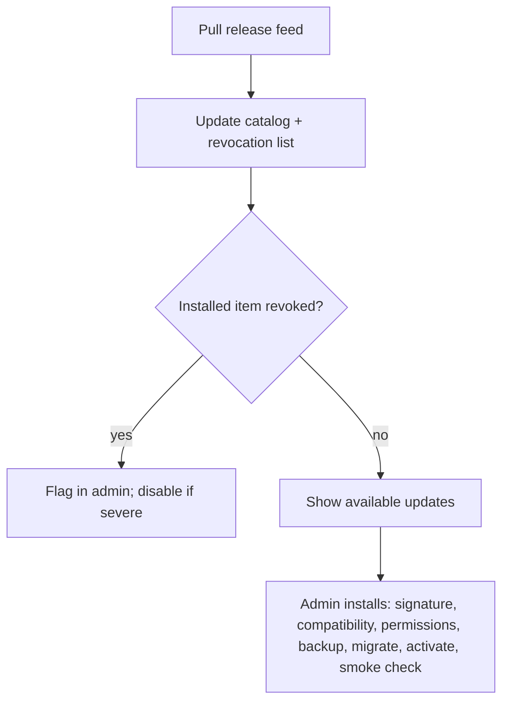
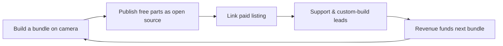

# 13. Marketplace and licensing

The marketplace lists modules, vertical bundles and agent packs, free and paid. It starts as a **static Git catalog** and becomes a service only when volume justifies it.

## What is sold

| Item | Free or paid | Who sells |
| --- | --- | --- |
| Building-block modules | Mostly free, some paid | Project and community |
| Vertical bundles | Paid, one-time or yearly license | Project first, community later |
| Agent packs (prebuilt agents with tested instructions) | Free starter, paid library | Project and community |
| Support and custom builds | Paid | Project and partners |

## Catalog evolution

## Licensing

Paid items use **offline signed license keys**, so installs never phone home.

### What a key carries

Seat counts, bundle IDs, and the term. It is verified with a public key embedded in the app. No network call is needed.

### What happens at limits and expiry

| Situation | Behaviour |
| --- | --- |
| Over the builder seat limit | Warn and block adding more builders. **Never lock out existing users** |
| Bundle on one-time license | Runs forever, with a set period of updates |
| Bundle on yearly license expired | Keeps running at the last version received. No updates or support |
| Seat license expired | Advanced features switch off after a **grace period** |
| Any case | **Data and the free base are never locked** |

## Trust and delivery

Packages are **signed** and carry **digests**. Each listing shows a label: **Official**, **Verified** or **Community**.

Install order: download, verify signature, check compatibility, show permissions, back up, migrate, activate, smoke check.

A **revocation list** travels inside the pull-only release feed.

## Payments

Use a payment provider that handles **sales tax and VAT** (a merchant-of-record style provider). Add seller payouts only when third-party sellers exist.

## Distribution flywheel

With no marketing budget, distribution is the channel itself:

## Open questions

- Which payment provider
- Format of the signed catalog entry and key format
- Verified-label criteria for third-party sellers
