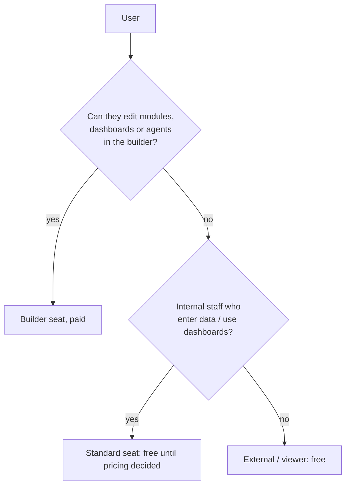
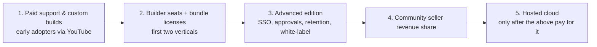

# 14. Pricing and monetization

The free base has **no user limit**. Money comes from builder seats, bundle licenses and services. Licensing is AGPL-3.0 for the core, with paid proprietary bundles and modules.

## Price table

| Item | Price | Billing | What it includes |
| --- | --- | --- | --- |
| Free base | $0 | None | Unlimited users, data builder, views, dashboards, module installer, agent runtime, model gateway, community support |
| Builder seat | **$49 per seat per month** | Monthly, or a yearly key (price to be set) | Advanced features for people who edit modules, dashboards and agents: SSO, approvals, retention, white-labelling, full agent library, support |
| Standard seat | To decide after interviews; free until then | Same as builder seat | Managers and staff who enter data and use dashboards |
| Bundle license | Set per bundle after interviews | One-time or yearly | One-time: licensed version runs forever, with a set update period. Yearly: updates and support while active |
| Services | Quoted per project | Per project | Support, custom builds, training |

## What counts as a seat

A **named user who works in the no-code builder**: dragging and dropping views and dashboards, installing and combining modules, and setting up agents without code.

- Counted **by capability, not job title**
- **Viewers and external users** (customers, candidates) are free
- **Agents are not seats**, and their runs are not metered. Local runs cost nothing and metering would need a connection back to the project

## How keys work

A license key is **signed and works offline**. It carries seat counts, bundle IDs and the term. The app counts active builders. Over the limit it warns and blocks adding more builders; it **never locks out existing users**.

Monthly seats need a fresh key every month, which the owner can pull from the admin screen. **Air-gapped installs should use yearly keys.**

## When a license ends

| License | After expiry |
| --- | --- |
| Bundle, one-time | Keeps running |
| Bundle, yearly | Keeps running at the last version received |
| Seat | Advanced features switch off after a grace period |
| Anything | Data and the free base are never locked |

## Revenue order

## Why this model

| Choice | Reason |
| --- | --- |
| AGPL core | Open and adoptable, and protects against closed SaaS forks |
| Paid proprietary bundles/modules | Revenue without crippling the core |
| Seats counted on builders only | Aligns price with value (people who configure), keeps adoption broad |
| Offline keys, no metering | Required for sovereign and air-gapped customers |
| No hosted cloud first | No ops burden or cash need before revenue |

## Illustrative example

A 10-person booking business with 2 people who configure dashboards: free base, 2 builder seats = $98/month, plus the booking bundle license (price TBD). The other 8 staff and all customers cost nothing.

## To decide (after interviews)

- Bundle prices and the update period for one-time licenses
- Standard seat price
- Yearly price for builder seats
- Length of the grace period for expired seat licenses
