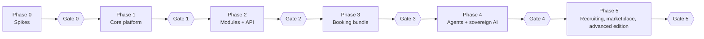
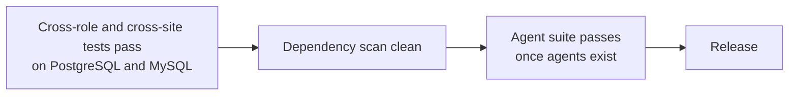
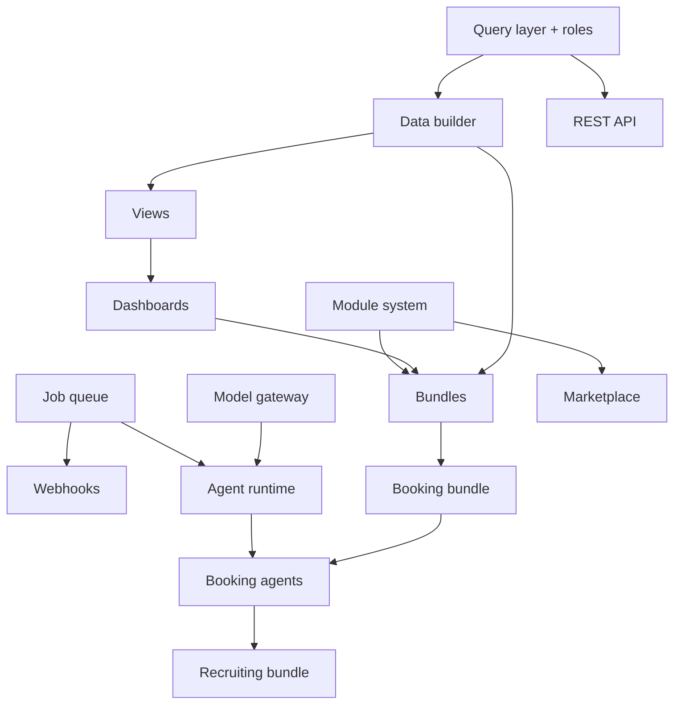

# 15. Module plan and roadmap

This is **what we build, step by step**.

> **Status of this doc.** The source note says the roadmap has *5 phases and 5 gates* but its figure was not available as text. The phase numbers for integrations (REST, OpenAPI and webhooks in phase 2; n8n, MCP and model servers in phase 4) and the rule that agents come after the booking bundle are **decided**. The rest of the phase contents, deliverables and gate criteria below are **proposed** to fill in the gaps. Reconcile with the original figure and adjust.
>
> Durations are not set, because they depend on the hours available and on the spikes. Order matters; dates do not (yet).

> **Builders added later.** The theme, form, page, widget and agent builders ([docs 18-23](18-builder-studio-overview.md)) are placed in the phases below. The near-term, week-by-week slice of this roadmap is in [doc 24](24-three-month-plan.md).

| Builder | Foundations | Full builder |
| --- | --- | --- |
| Theme (light/dark) | Phase 1: tokens in every component | Phase 2 |
| Form | Phase 1: basic form view | Phase 2/3: drag-and-drop, public forms, logic |
| Page | Phase 1: dashboard grid | Phase 2/3: app, portal and public pages |
| Widget | Phase 1: chart and number cards | Phase 2: widget builder and library |
| Agent | Phase 4: runtime | Phase 4: builder UI (JSON editor earlier, for testing) |

## Overview

The note counts five phases. The spikes are shown as Phase 0 because the note makes them prerequisites; fold them into Phase 1 if the original figure does.

**Why agents come after the booking bundle:** the agent library needs a real bundle to automate, and the booking gate is the first test of the whole idea.

## Phase 0: Spikes and validation

Decide the risky things cheaply before building on them.

| Spike / task | Time box | Decides |
| --- | --- | --- |
| Install and remove a module at runtime on NestJS | 1 week | NestJS vs Next.js fallback |
| Kysely vs Drizzle on both databases, incl. staged schema changes | 1 week | Query layer |
| Dashboard grid and view builder: existing library vs own | 1 week | UI foundation |
| Run 3-4 local models via Ollama on the booking reminder agent | 1 week | Capability profile format, tested-model list |
| Compare NocoBase, Budibase, Appsmith | Research | Differentiation |
| Compare Dify, Flowise, Langflow, n8n | Research | Differentiation |
| Interview three sovereignty-minded companies | Interviews | Willingness to pay |
| Confirm booking with three real businesses | Interviews | First bundle |
| Confirm name; check domain, GitHub org, `@dashground` npm scope, Docker Hub, trademarks | Admin | Branding |

**Gate 0 (proposed):** the module-runtime spike has a clear pass/fail, a query layer is chosen, at least three conversations confirm demand, and the name is cleared.

## Phase 1: Core platform (free base, foundation)

Goal: a user can log in, define data, see it in views and dashboards. No modules yet.

| Step | Deliverable | Doc |
| --- | --- | --- |
| 1.1 | Monorepo (pnpm + Turborepo), CI on PostgreSQL 16 **and** MySQL 8.4 from the first commit | [11](11-tech-stack-and-database.md) |
| 1.2 | Server skeleton: NestJS + Fastify, config, health, logging | [03](03-architecture.md) |
| 1.3 | Auth: Argon2id, cookie sessions, CSRF, rate limits, optional TOTP | [10](10-security.md) |
| 1.4 | Roles, **query layer** with `site_id` and row-level rules, **boundary test suite** | [05](05-views-and-dashboards.md) |
| 1.5 | **Data builder**: collections, fields, relations, staged schema changes, soft delete | [04](04-data-builder.md) |
| 1.6 | Views: table, form, then kanban, calendar, detail, chart (Zod-validated JSON) | [05](05-views-and-dashboards.md) |
| 1.7 | Dashboards: drag-and-drop grid, shared filters, versioning | [05](05-views-and-dashboards.md) |
| 1.8 | Audit log (basic), file storage (local, S3-compatible), SMTP | [12](12-setup-and-deployment.md) |
| 1.9 | Admin UI shell (React + Vite) served by the same server | [03](03-architecture.md) |
| 1.10 | Docker image, Compose file, setup wizard (no AI step yet), backup before migration | [12](12-setup-and-deployment.md) |

**Gate 1 (proposed):** a non-developer can install with Compose, create a collection, build a table view and a dashboard. Boundary tests pass on both databases. A staged schema change survives a deliberate mid-way failure.

## Phase 2: Modules, API and job queue

Goal: the product is extensible and integrable.

| Step | Deliverable | Doc |
| --- | --- | --- |
| 2.1 | Database-backed job queue with `SKIP LOCKED` | [03](03-architecture.md) |
| 2.2 | Module SDK (`defineModule`), manifest validation, lifecycle (install, migrate, register, activate, seed, deactivate, uninstall, purge) | [06](06-modules-and-bundles.md) |
| 2.3 | Module installer UI, permission prompts, backup and smoke check, rollback | [06](06-modules-and-bundles.md) |
| 2.4 | Trust tiers and package signing, digest verification | [06](06-modules-and-bundles.md), [13](13-marketplace-and-licensing.md) |
| 2.5 | REST API with scoped tokens | [09](09-integrations.md) |
| 2.6 | OpenAPI generated from Zod | [09](09-integrations.md) |
| 2.7 | Signed, retried outbound webhooks | [09](09-integrations.md) |
| 2.8 | Building-block modules: contacts, scheduling, notifications | [02](02-product-model.md) |
| 2.9 | CLI scaffolding for modules, `create-dashground` installer | [12](12-setup-and-deployment.md) |
| 2.10 | Static Git catalog (read-only) and offline license verification | [13](13-marketplace-and-licensing.md) |

**Gate 2 (proposed):** a third-party-style declarative module installs, migrates, runs and uninstalls cleanly on both databases; a failed install rolls back; API tokens respect row-level rules.

## Phase 3: Booking bundle (first vertical)

Goal: **the first test of the whole idea.** Without agents.

| Step | Deliverable |
| --- | --- |
| 3.1 | Validate the booking data model with three real businesses |
| 3.2 | Bundle manifest format and bundle installer (dependency order, config, seed) |
| 3.3 | Collections: customers, services, staff, bookings, payments (basic) |
| 3.4 | Views: booking calendar, booking form, customer detail, kanban by status |
| 3.5 | Dashboards: today, this week, revenue by service, no-show rate |
| 3.6 | Workflows: confirm booking, cancel, reschedule, notifications |
| 3.7 | Demo data and a free demo mode, license check for the full bundle |
| 3.8 | Build it on camera; publish; first paid support leads |
| 3.9 | Builder seat gating (advanced roles, approvals) |

**Gate 3 (proposed):** at least one real business runs on it; the free/paid line is reviewed; first revenue from support, seats or a bundle license.

## Phase 4: Agents and sovereign AI

Goal: agents inside a permissioned app, on local or public models.

| Step | Deliverable | Doc |
| --- | --- | --- |
| 4.1 | **Model gateway**: OpenAI-compatible provider, Ollama first, then vLLM, llama.cpp, LM Studio; public APIs with owner keys | [08](08-sovereign-ai-and-model-gateway.md) |
| 4.2 | Capability profiles and the model test in the setup wizard | [08](08-sovereign-ai-and-model-gateway.md) |
| 4.3 | Tool registry (read, write, configuration, outbound), Zod-validated | [07](07-agents.md) |
| 4.4 | Agent runtime: triggers, runs, step limits, budgets, timeouts, kill switch | [07](07-agents.md) |
| 4.5 | Agent roles (least privilege), approval inbox, run log, dry-run | [07](07-agents.md) |
| 4.6 | Data-class tags and gateway routing; concurrency limits and priority queue | [08](08-sovereign-ai-and-model-gateway.md) |
| 4.7 | Air-gapped mode and egress report | [08](08-sovereign-ai-and-model-gateway.md) |
| 4.8 | Starter agents for booking (reminder, no-show follow-up, answer agent) with eval suites | [07](07-agents.md) |
| 4.9 | Customization agent (config diffs) with guided templates for weaker models | [07](07-agents.md) |
| 4.10 | MCP server and client, n8n node | [09](09-integrations.md) |
| 4.11 | Agent security suite: injection, budget exhaustion, tool misuse | [10](10-security.md) |

**Gate 4 (proposed):** the booking reminder agent passes its eval on at least one local model; the security agent suite is green; an air-gapped install runs with an empty egress report.

## Phase 5: Second vertical, marketplace and advanced edition

| Step | Deliverable |
| --- | --- |
| 5.1 | Recruiting bundle (pipeline, candidates, CV-screening agent that produces a draft shortlist) |
| 5.2 | Advanced edition: SSO, approvals, retention rules, white-labelling |
| 5.3 | Full agent pack library (paid) |
| 5.4 | Marketplace: Verified labels, revocation list, community listings |
| 5.5 | Independent security review (**required before 1.0**) |
| 5.6 | 1.0 release, `SECURITY.md`, documented upgrade path |

**Gate 5 (proposed):** independent review findings resolved; two bundles in real use; revenue covers continued development.

## Later (not scheduled)

- Healthcare bundle: only with a partner or an audit
- Zapier app: on demand
- Community seller payouts: when third-party sellers exist
- Hosted cloud: only after revenue pays for running it

## Release gates that apply to every phase

## Dependency map

## Working method

1. Write the decision down before building it.
2. Spike risky choices for one week with a clear pass/fail.
3. Build each bundle on camera and publish.
4. Keep the core small. Push capability into modules.
5. Invite contributors early; the single-maintainer risk is real.
