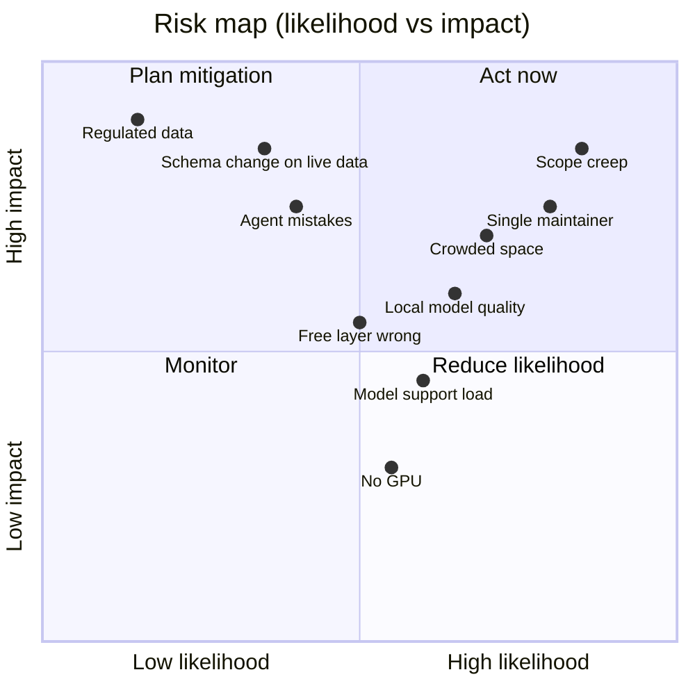

# 16. Risks and open decisions

## Risks

| Risk | Why it matters | Response |
| --- | --- | --- |
| Scope is four products at once | The base, module system, a vertical and agents each need a full build | Strict order in the roadmap; ship the booking bundle before the agent library |
| Crowded space | Budibase, Appsmith, NocoBase, Baserow, Frappe and Retool already serve internal tools | Differentiate on installable vertical bundles and governed agents; study NocoBase before committing |
| Crowded agent tooling | Dify, Flowise, Langflow and n8n may already work with local models | Compete on agents inside a permissioned business app with vertical bundles; verify the comparison before launch |
| Local models are weaker than public ones | Customers on modest hardware get worse results and may blame the product | Capability profiles, per-agent evals, a tested-models list, and no promise of parity |
| Support load from model setups | "It doesn't work with my model" becomes the main ticket | The wizard's model test, published hardware guidance, and an eval report owners can attach to a ticket |
| No GPU at small companies | Many SMEs have no local hardware | Private-cloud and public providers stay supported; the product works with AI off |
| Free layer too thin or too rich | Thin means no adoption; rich means no sales | Review after the first ten real installs |
| Agent mistakes | A wrong email or record change harms a customer | Approvals by default, dry-run, audit log, budgets |
| Schema changes on live data | Users edit their own schema, and MySQL cannot roll back DDL | Staged changes, backup first, tests on both databases |
| Single maintainer | Bus factor of one | Document decisions, keep the core small, invite contributors early |
| Regulated data | Healthcare brings legal duties | No clinic bundle until there is a partner or an audit |

### Risk heat map (qualitative, proposed)

The placement is a first guess for discussion, not data.

### Added with the builders and the 3-month plan (proposed)

| Risk | Why it matters | Response |
| --- | --- | --- |
| Six builders widen the scope further | Each builder is a product in itself | Shared renderer and shared rules ([doc 18](18-builder-studio-overview.md)); scope ladder in [doc 24](24-three-month-plan.md) |
| Public forms and pages expose data | A mistake leaks records to anyone | Dedicated least-privilege public role, create-only forms, tests in docs 20 and 21 |
| Cached widget results cross access scopes | One user could see another's rows | Cache key includes access scope; named security test ([doc 22](22-widget-builder.md)) |
| AI-assisted coding quality | Plausible but wrong code in security-critical paths | Human-written protected paths, dual-database tests, review loop ([doc 24](24-three-month-plan.md)) |
| 3-month plan optimism | Hours per week and AI speed-up are unmeasured | Weekly metrics, checkpoints on 4 Dec and 1 Jan, gate review on 5 Feb |

## Open decisions

### Spikes

- [ ] Install and remove a module at runtime on NestJS. If it fails, fall back to Next.js and a rebuild step.
- [ ] Kysely against Drizzle on both databases, including staged schema changes.
- [ ] Dashboard grid and view builder: build on an existing library or write our own.
- [ ] Run three or four local models of different sizes through Ollama on the booking reminder agent, testing tool calling and structured output, to set the capability profile format.

### Research

- [ ] Compare NocoBase, Budibase and Appsmith, and write down what we do differently.
- [ ] Compare Dify, Flowise, Langflow and n8n on local-model agents, and write down what we do differently.

### Customer validation

- [ ] Interview three companies that care about data sovereignty and confirm they would pay.
- [ ] Confirm the first bundle (booking) with three real businesses before building it.

### Naming and branding

- [ ] Confirm the working name Dashground, or change it. Check the domain, GitHub organization, npm scope (`@dashground`), Docker Hub name and trademarks first.

### Product and pricing

- [ ] Decide which model servers the gateway supports first (Ollama, vLLM, llama.cpp server, LM Studio) and which public providers.
- [ ] Set bundle prices, the standard seat price and the update period for one-time licenses, using what the interviews show.
- [ ] Decide the yearly price for builder seats, and confirm that expired seat licenses switch off advanced features after a grace period.

## Additional questions raised while writing these docs (proposed)

These are not in the source note. Raise them if you agree they matter.

| Question | Why it matters |
| --- | --- |
| Multi-tenancy: is `site_id` one site per install, or multiple sites per install? | Affects the data boundary, licensing and the website module |
| Exact shape of the workflow engine (triggers, steps, conditions) | Workflows appear in bundles but are not specified in the note |
| Agent approval timeouts and who receives approvals | Needed for the approval inbox design |
| Backup mechanism inside the app for MySQL and PostgreSQL | "Back up before every migration" needs a concrete method, including managed databases |
| License key format and public-key rotation | Needed for offline verification and key compromise handling |
| Localization and time zones | Booking bundles are timezone-sensitive |
| Telemetry policy | Opt-in anonymous install counts could help the "first ten installs" review but conflict with sovereign messaging |
| Contribution model and CLA | AGPL core plus proprietary bundles usually needs a CLA or clear boundaries |
| Trademark and AGPL implications of paid bundles that link against the core | Needs legal review |

## Decision log

| Date | Decision | Source |
| --- | --- | --- |
| 2026-11-04 | Dashboard platform with vertical bundles, replacing the website builder | Architecture note |
| 2026-11-04 | Agents replace AI-written code as the customization path | Architecture note |
| 2026-11-04 | Sovereign AI first, one model gateway | Architecture note |
| 2026-11-04 | Booking first, then recruiting; healthcare later | Architecture note |
| 2026-11-04 | AGPL-3.0 core, offline signed licenses, $49/month builder seat | Architecture note |
