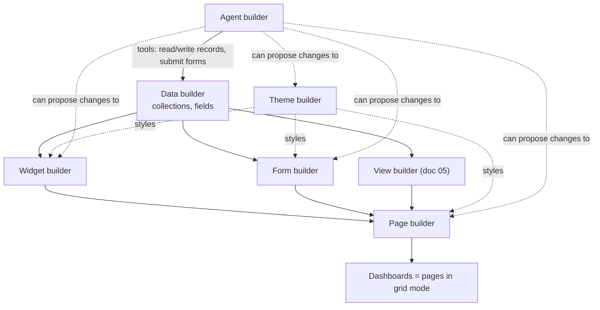
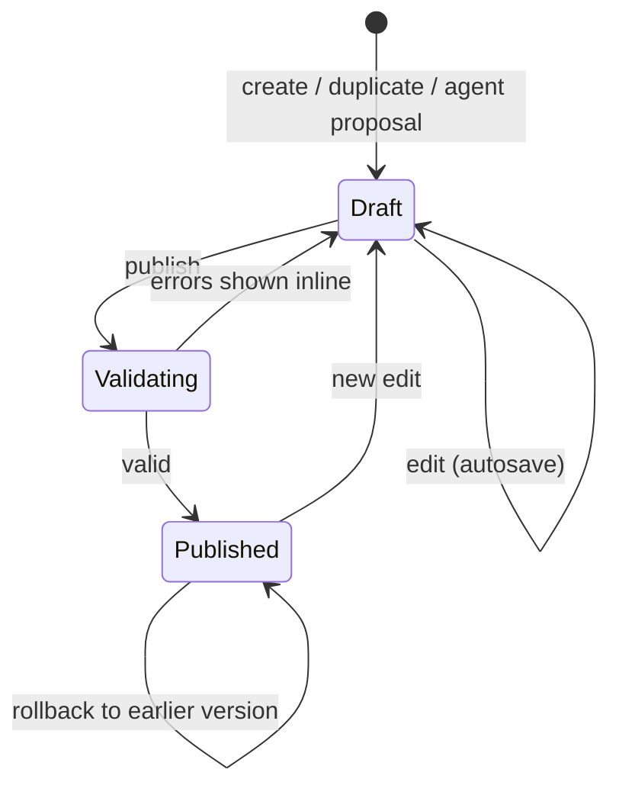
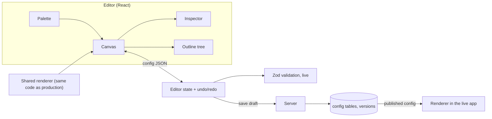

# 18. Builder studio overview

> **Status: proposed.** The builders in docs 18-23 extend the architecture note. They follow its rules: everything a builder produces is **validated declarative configuration** (Zod-checked JSON), never executable code, so it can be versioned, diffed, permissioned, bundled and proposed by agents.

## What the studio is

The **builder studio** is the part of the admin UI where a builder (see [builder seat](14-pricing-and-monetization.md)) shapes the app without code. It already had the data builder ([04](04-data-builder.md)) and the view and dashboard builder ([05](05-views-and-dashboards.md)). This set adds five more:

| Builder | Produces | Doc |
| --- | --- | --- |
| **Theme builder** | Design tokens, light and dark | [19](19-theme-builder.md) |
| **Form builder** | Drag-and-drop forms with logic | [20](20-form-builder.md) |
| **Page builder** | Drag-and-drop pages composed of widgets, forms, views | [21](21-page-builder.md) |
| **Widget builder** | Reusable widgets bound to queries | [22](22-widget-builder.md) |
| **Agent builder** | Agent definitions, tools, approvals, tests | [23](23-agent-builder.md) |

## How they relate

## Shared rules

1. **Config, not code.** Each builder saves JSON validated by a Zod schema that lives in `packages/schemas`. The editor, the renderer, the API and agent tools all use that schema.
2. **Versioned.** Every save is a version. Publishing is explicit. Rollback is one click (same model as dashboards).
3. **Drafts are private.** A builder edits a draft; end users only see the published version.
4. **Same data boundary.** Anything a builder renders reads through the query layer, so roles and row-level rules apply to forms, pages and widgets exactly as they do to views.
5. **Dependency-aware.** Deleting a field, widget or form shows what uses it before it is allowed.
6. **Agents can propose, people approve.** Agents use the configuration tools to propose a diff against any of these configs. Never applied without approval.
7. **Packageable.** Modules and bundles ship these configs, and installing a bundle registers them.

## Shared lifecycle

## Shared editor architecture

The editor canvas uses the **same renderer** as the live app, so what you see in the builder is what users get. The renderer choice (own vs existing library) is the open UI spike in [doc 16](16-risks-and-open-decisions.md).

## Free vs paid (proposed)

| Builder | Free base | Paid |
| --- | --- | --- |
| Theme | One light and one dark theme, color and typography tokens | Multiple themes, white-labelling (already a paid feature) |
| Form | Full drag-and-drop, validation, conditional fields | Approval steps, multi-step with e-signature (later) |
| Page | Full drag-and-drop pages | Public portals with custom domain branding |
| Widget | Built-in widget library, custom widgets from queries | Widget packs in bundles |
| Agent | Runtime, bring-your-own model, starter agents | Full agent library |

The principle from [doc 02](02-product-model.md) holds: the base must be useful, but generic enough that it does not replace a bundle.

## Builder permissions

| Permission | Allows |
| --- | --- |
| `builder.theme` | Edit and publish themes |
| `builder.form` | Create and edit forms |
| `builder.page` | Create and edit pages |
| `builder.widget` | Create and edit widgets |
| `builder.agent` | Create and edit agents |
| `builder.publish` | Publish changes (can be separated from editing) |

Users with any of these are **builders** and count toward builder seats. Publishing can require approval in the paid edition.
