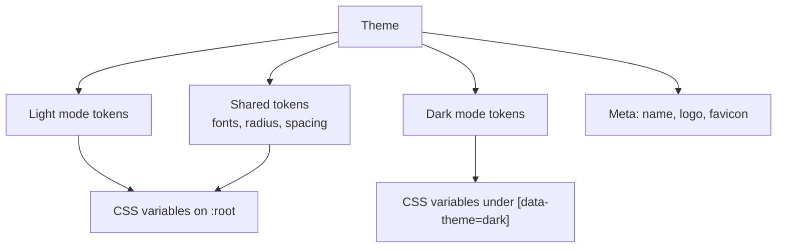
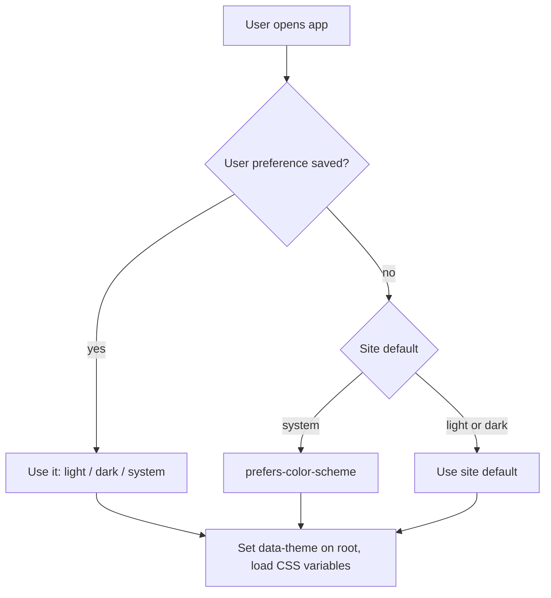
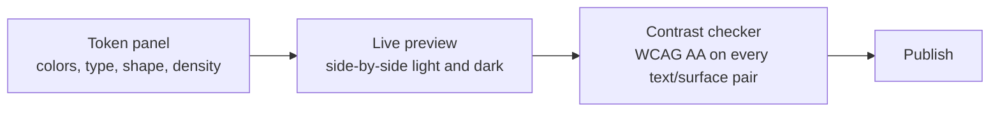
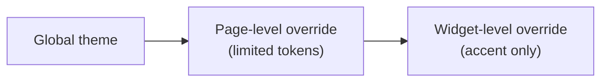

# 19. Theme builder (light and dark)

> **Status: proposed.**

## Goal

Let a company make the app look like its own, with **light and dark modes** that always stay readable, without writing CSS.

## Design tokens

A theme is a set of **tokens**, not styles. Components only ever reference tokens, so changing a token restyles everything consistently.

| Group | Tokens (examples) |
| --- | --- |
| Color: surface | `bg`, `bg-subtle`, `surface`, `surface-raised`, `border` |
| Color: text | `text`, `text-muted`, `text-on-accent` |
| Color: brand | `accent`, `accent-hover`, `accent-subtle` |
| Color: status | `success`, `warning`, `danger`, `info` |
| Color: data | An ordered categorical palette for charts (8 colors) and a sequential ramp |
| Typography | `font-body`, `font-heading`, `font-mono`, size scale, line heights, weights |
| Shape | `radius-sm/md/lg`, border widths |
| Spacing | Density: compact, comfortable, spacious (scales spacing tokens) |
| Elevation | Shadow scale |
| Motion | Duration and easing, with reduced-motion respected |

## Theme model



Example (illustrative; validated by Zod):

```json
{
  "id": "theme_default",
  "name": "Dashground default",
  "shared": { "fontBody": "Inter", "radius": { "md": 8 }, "density": "comfortable" },
  "light": { "bg": "#ffffff", "text": "#111827", "accent": "#2563eb", "data": ["#2563eb", "#16a34a", "#d97706"] },
  "dark":  { "bg": "#0b1220", "text": "#e5e7eb", "accent": "#60a5fa", "data": ["#60a5fa", "#4ade80", "#fbbf24"] }
}
```

## Light and dark behaviour



- Three options: **Light**, **Dark**, **System**.
- Site owner sets the default; each user can override, stored in their profile.
- No flash on load: the mode is applied before first paint.
- Public pages and portals follow the same logic, and can be forced to one mode.

## Editor experience



Features:

1. **Start from a preset** (or from one brand color: the builder derives a full palette for both modes).
2. **Side-by-side light and dark preview** on real components: table, form, chart, kanban, dashboard.
3. **Automatic contrast checking.** Text/surface pairs below WCAG AA are flagged, and publishing a failing theme requires explicit override.
4. **Chart palette validation:** categorical colors must be distinguishable, in both modes.
5. **Logo and favicon** upload (separate light and dark logos).
6. **Import and export** a theme as JSON, so bundles can ship themes.
7. **Reset to default** at any time.

## Where themes apply

| Surface | Behaviour |
| --- | --- |
| Admin UI | Site theme, user mode preference |
| Pages, forms, widgets, dashboards | Reference tokens only |
| Public pages and portals | Site theme, optional separate public theme |
| Emails | A reduced set of tokens (brand color, logo, font stack) compiled to inline styles |
| Print / PDF | Always light |

## Scoping and overrides



Overrides are deliberately limited to a few tokens to keep the app coherent and accessible.

## Security and safety

- Tokens are **validated values** (hex, rgb, named font from an allowlist or an uploaded font file). No raw CSS is accepted, so a theme cannot inject script or exfiltrate data.
- Custom fonts are uploaded to file storage and self-hosted. No Google Fonts call is made, which keeps **air-gapped** installs clean and the egress report empty.
- Agents can propose theme changes through the configuration tool as a diff, subject to the contrast check.

## Versioning

Same lifecycle as other builders ([doc 18](18-builder-studio-overview.md)). Switching the active theme is instant and reversible.

## Tests

- Every default and preset theme passes WCAG AA in both modes.
- Charts remain legible in dark mode.
- Reduced-motion and system preference respected.
- No external network request is made to load fonts or assets.

## Roadmap placement

Foundations (tokens, light/dark) land in **Phase 1** so every component is built on tokens from day one; the full theme builder UI lands in **Phase 2**. See [doc 15](15-module-plan-and-roadmap.md).
