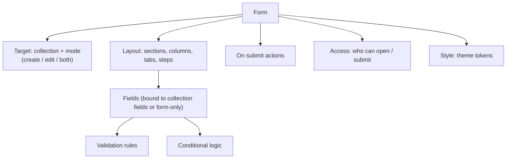
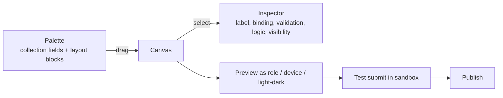
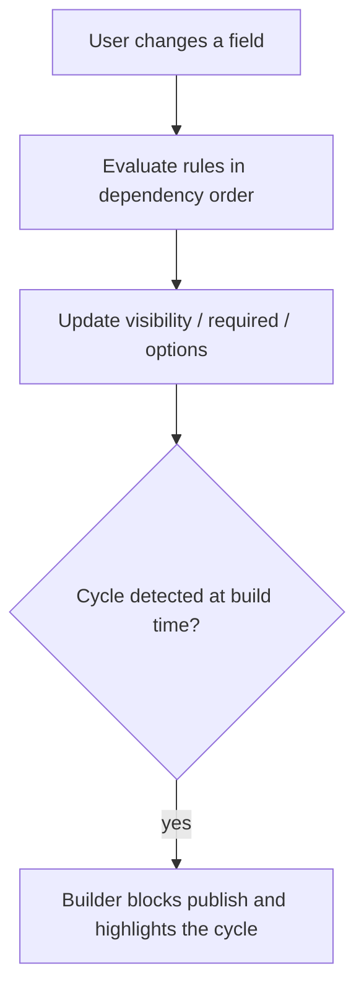
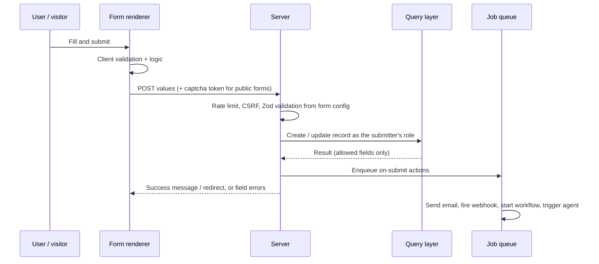

# 20. Form builder

> **Status: proposed.** Extends the "Form" view in [doc 05](05-views-and-dashboards.md) into a full drag-and-drop builder.

## Goal

Let a builder design forms (internal data entry, customer-facing intake, booking requests, candidate applications) by dragging fields onto a canvas, with validation and conditional logic, and no code.

## Where forms are used

| Use | Example |
| --- | --- |
| Internal create/edit | New booking, edit client |
| Public forms | Booking request, job application, contact form |
| Embedded in pages | A form widget inside a page ([doc 21](21-page-builder.md)) |
| Agent-assisted | An agent pre-fills or submits a form through a tool |

## Form model



## Field palette

| Group | Elements |
| --- | --- |
| Data fields | One input for each field type in the data builder: text, long text, number, money, date/time, boolean, select, multi-select, relation picker, file upload, JSON |
| Layout | Section, columns, tabs, steps, divider, spacer |
| Content | Heading, rich text, help text, image |
| Special | Repeating group (child records), signature (later), captcha, hidden field |

Fields are **bound** to a collection field by default, so label, type, options and base validation come from the data builder. A form can add display-level overrides (label, placeholder, help, order) without changing the schema. Form-only fields (e.g. "I agree to terms") are allowed and stored only if mapped.

## Builder experience



Features: undo/redo, keyboard reordering, responsive preview (desktop, tablet, phone), preview as a chosen role, duplicate, import/export.

## Validation

Layered, always re-checked on the server:

1. **Type validation** inherited from the field type.
2. **Rules** configured in the builder: required, min/max, length, pattern, unique, date ranges, cross-field (end after start).
3. **Server-side Zod validation** generated from the form config. Client checks are for convenience only.

## Conditional logic

Rules of the form **when / then**:

```json
{ "when": { "field": "service", "op": "eq", "value": "consultation" },
  "then": [{ "show": "notes" }, { "require": "phone" }] }
```

Supported effects: show/hide, enable/disable, require, set value, restrict select options. Rules are declarative and evaluated by the shared renderer in the browser and again on the server. There is no scripting.



## Multi-step forms

Steps are ordered sections with their own validation gate. Progress is saved as a draft record (for authenticated users) or in a signed, expiring token (for public forms).

## Submit flow



### On-submit actions (declarative)

Create or update record, send a confirmation email, fire an outbound webhook, start a workflow, trigger an agent, redirect or show a message. Outbound actions follow the same destination and tag rules as [integrations](09-integrations.md).

## Access and security for public forms

| Risk | Control |
| --- | --- |
| Spam and bots | Rate limits, captcha option (self-hostable), honeypot field |
| Data injection | Server-side Zod validation, parameterized queries |
| Over-posting (extra fields) | Only fields in the published form config are accepted |
| Unauthorized read | A public form grants **create only** through a dedicated, least-privilege public role. It cannot read existing records |
| File abuse | Type and size checks, storage outside the web root, no execution |
| Personal data | Fields can be tagged; tagged data follows gateway and destination rules if an agent or webhook consumes it |

## Agent integration

- **Tools:** `forms.list`, `forms.get` (read); `records.create` through a form's validation (write, approval configurable).
- **Customization:** an agent can propose a form (or a change to one) through the configuration tool. It is validated and shown as a diff for approval.
- Example: "add a 'preferred time' field to the booking form" yields a diff touching the data builder (new field) and the form (new element), approved together.

## Versioning and submissions

Forms are versioned. Each submission records the **form version** that produced it, so old submissions remain interpretable after the form changes.

## Tests

- Server rejects values the client allowed (tampered request).
- Hidden-by-logic fields are not accepted or are cleared server-side.
- Public role cannot read records.
- Over-posted fields are dropped or rejected.
- Logic cycles are caught at publish time.

## Roadmap placement

Basic form view in **Phase 1**; the full drag-and-drop form builder, public forms and logic in **Phase 2/3** (required for the booking bundle). See [doc 15](15-module-plan-and-roadmap.md).
