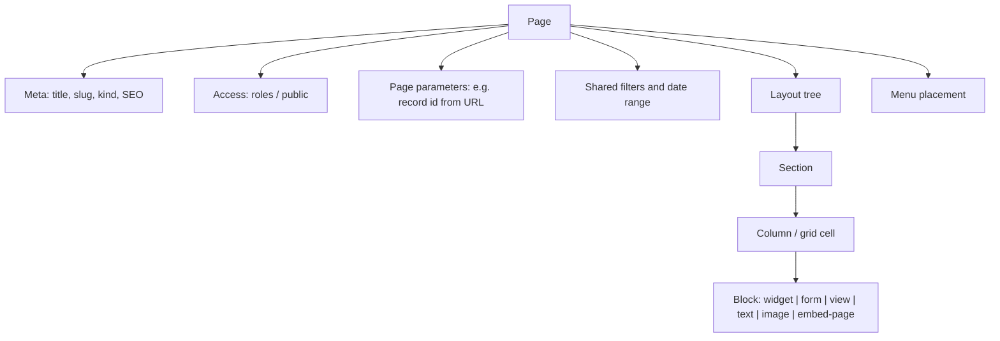
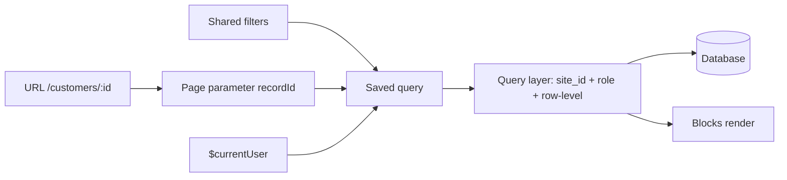
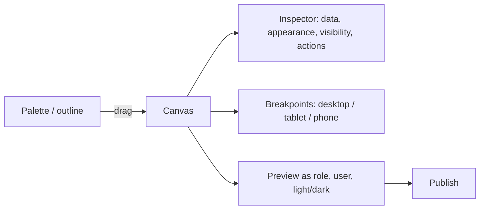
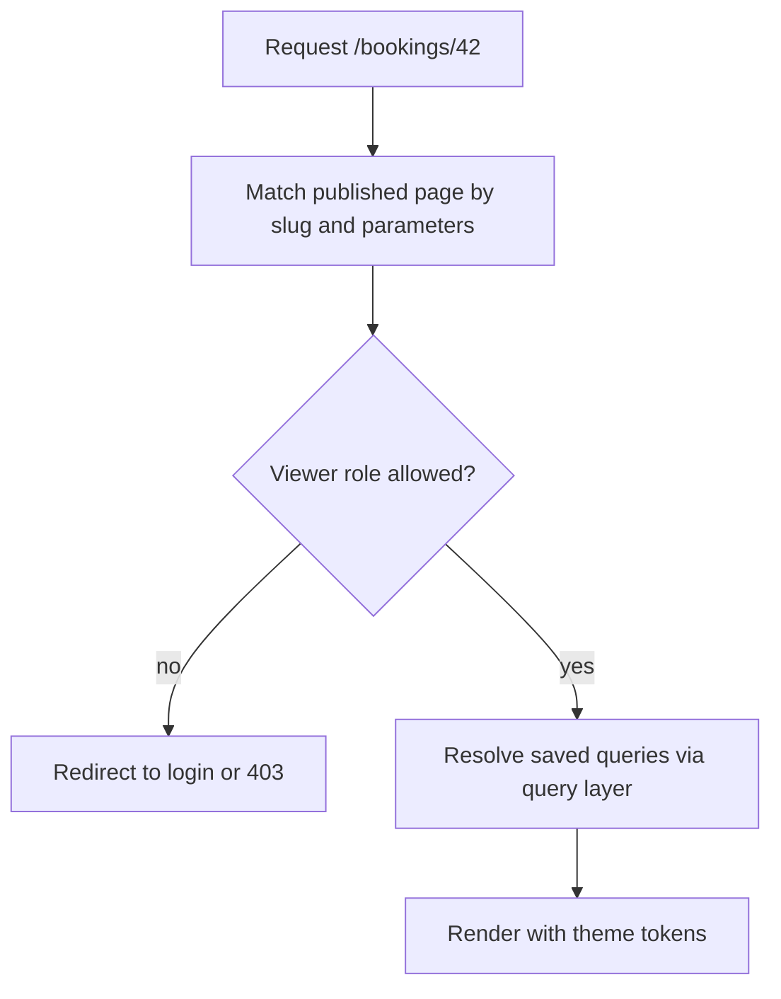

# 21. Page builder

> **Status: proposed.** Generalizes the dashboard grid ([doc 05](05-views-and-dashboards.md)) and the website module into one drag-and-drop page system.

## Goal

Let a builder compose **pages**: internal screens, dashboards, customer portals and public pages, by dragging widgets, forms and views onto a layout.

## One system, several page kinds

| Page kind | Audience | Layout | Notes |
| --- | --- | --- | --- |
| **Dashboard page** | Staff | Grid of cards | What [doc 05](05-views-and-dashboards.md) calls a dashboard. Shared date range and filters |
| **App page** | Staff | Free sections and columns | Record pages, home pages, menu destinations |
| **Portal page** | Customers, candidates | Sections | Behind a login with a restricted role |
| **Public page** | Anyone | Sections | Server-rendered; website module; SEO fields |

A dashboard is therefore a page in grid mode, not a separate concept. This avoids two builders doing the same job.

## Page model

## Blocks you can drop

| Block | Source |
| --- | --- |
| Widget | Built-in or custom, from the widget builder ([doc 22](22-widget-builder.md)) |
| Form | A published form ([doc 20](20-form-builder.md)) |
| View | Table, kanban, calendar, detail, chart views ([doc 05](05-views-and-dashboards.md)) |
| Content | Heading, rich text, image, button, link, divider, spacer |
| Layout | Section, columns, tabs, accordion, repeater |
| Page reference | Embed another page (e.g. shared header) |
| Agent | An "ask the assistant" box bound to a configured *answer* agent ([doc 23](23-agent-builder.md)) |

## Data binding

Blocks do not fetch arbitrary data. They bind to:

- A **saved query** (collection, filters, sort, aggregation)
- **Page parameters** (for example `recordId` from the URL)
- **Shared filters** (date range, selected customer)
- The **current user** (`$currentUser`)

Everything passes the query layer, so a page can never show more than the viewer's role allows, even if the page itself is public or shared.

## Builder experience

Features: snap-to-grid, nested sections, responsive overrides per breakpoint, undo/redo, duplicate, templates, page tree with menu placement, and **preview as role** so a builder sees what staff, a customer or a visitor sees.

### Visibility rules

Per block: show/hide by role, by condition on data ("only if status = open"), or by device. Declarative, evaluated on server and client. This is for convenience; **data security never depends on hiding a block**.

### Actions

Declarative block actions: navigate, open a form in a drawer, set a shared filter, run a workflow, call an approved agent, download an export. No scripting.

## Routing and menus

Pages register in the admin menu from the builder or from a module manifest (`admin.menu`, see [doc 06](06-modules-and-bundles.md)).

## Rendering modes

| Kind | Rendering |
| --- | --- |
| Dashboard, app, portal pages | Client-rendered React (static admin assets) |
| Public pages | Server-rendered React (SEO, fast first paint, caching) |

Public pages use caching with invalidation on publish. Only published widgets and forms may appear on public pages, and any query on a public page uses a dedicated, least-privilege public role.

## Public page safety

| Risk | Control |
| --- | --- |
| Data leak through a public page | Queries run as the public role only; builder warns when a public page binds to a collection the public role cannot read |
| XSS from rich text | Sanitized rich text with an allowlist; no raw HTML or script blocks |
| Embeds | Allowlisted embed hosts only, off in air-gapped mode unless allowed |
| Clickjacking, mixed content | Strict headers |

## Versioning

Pages are versioned like dashboards. Publishing a page that references an unpublished widget or form is blocked.

## Agent integration

- Agents can **propose pages or edits** (for example "add a revenue card to the home dashboard") through the configuration tool; the result is a validated diff.
- An *answer* agent can be embedded as a block, running with its own role and showing records it used.

## Tests

- Public role cannot read non-public collections via any page.
- Row-level rules hold in every block type.
- Page with a deleted dependency fails validation at publish, not at render.
- Responsive layouts do not hide required form fields.

## Roadmap placement

Dashboard grid in **Phase 1**; the general page builder, portal and public pages in **Phase 2/3** (booking needs a public booking page). See [doc 15](15-module-plan-and-roadmap.md).
