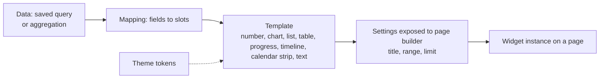
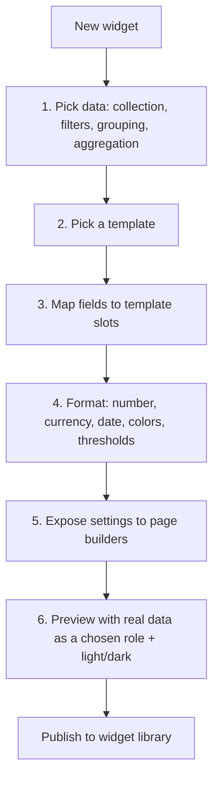
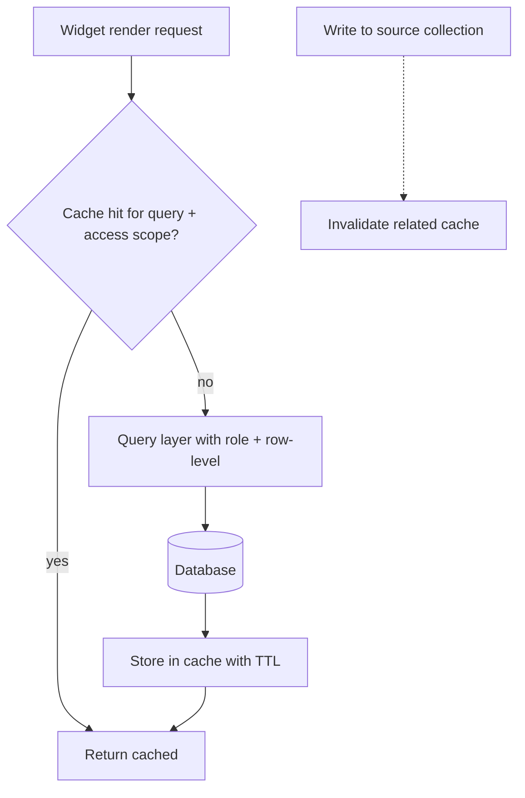

# 22. Widget builder

> **Status: proposed.**

## Goal

Let a builder create **reusable widgets** (a KPI with a trend, a "top clients" list, an upcoming-bookings strip) without code, and let developers ship richer ones in modules.

## What a widget is

A widget is a **configured, reusable block** that takes data from a query, presents it with a visual template, and exposes a few settings. Widgets are what dashboards and pages are built from ([doc 21](21-page-builder.md)).



## Widget sources (three tiers, matching trust tiers)

| Tier | Made by | Contains | Runs custom code? |
| --- | --- | --- | --- |
| **Built-in** | Project | Number card, trend card, bar/line/pie/area chart, table, list, kanban strip, calendar strip, progress, leaderboard, activity feed, text, image | Official code |
| **Composed (custom)** | Builder in the UI | Query + template + mapping + settings | **No** (declarative) |
| **Code widget** | Developer in a module | A React component registered through the SDK | Yes, in the community trust tier ([doc 06](06-modules-and-bundles.md)) |

Composed widgets are the default path and what the widget builder produces.

## Widget definition

```json
{
  "id": "widget_top_clients",
  "name": "Top clients",
  "template": "leaderboard",
  "query": {
    "collection": "booking",
    "group": ["customer"],
    "aggregate": [{ "fn": "sum", "field": "price", "as": "revenue" }],
    "filters": [{ "field": "starts_at", "op": "in_range", "value": "$page.dateRange" }],
    "sort": [{ "field": "revenue", "dir": "desc" }],
    "limit": "$setting.limit"
  },
  "mapping": { "label": "customer.name", "value": "revenue" },
  "settings": [{ "key": "limit", "type": "number", "default": 5, "min": 1, "max": 20 }],
  "format": { "value": "money" },
  "empty": "No bookings in this range"
}
```

Everything is validated by Zod. Values like `$page.dateRange` bind to the page's shared filters.

## Builder experience



Features:

- **Visual query builder** (no SQL) that compiles to the same saved-query JSON the views use
- **Live preview** with real data, as any role
- **Thresholds and conditional formatting** (red if no-show rate over 10 percent)
- **Empty, loading and error states** configured per widget
- **Drill-down:** click a value to open a filtered view or page
- **Duplicate a built-in** and customize it
- **Widget library** with search and categories; bundles can ship widgets

## Query model and performance

| Concern | Approach |
| --- | --- |
| Safety | Queries are structured JSON compiled by the query layer to parameterized SQL on both databases. No raw SQL widgets |
| Access | Roles, `site_id` and row-level rules apply to every widget query |
| Cost | Query limits (rows, timeout). Builder warns on unindexed filters |
| Speed | Per-widget cache with a TTL and invalidation on writes to the source collection; shared across viewers when the result is identical for their access scope |
| Consistency | Same query on a dashboard card and in a chart view returns the same result |



A cache key **must include the viewer's access scope**, so one user's cached result is never served to someone with different row-level rules. This is a named test in the security suite.

## Widget settings and page-level wiring

Settings let one widget serve many pages ("Top 5 clients", "Top 10 clients"). Page-level shared filters (date range, selected location) bind automatically to widgets that declare them.

## Code widgets (developers)

```ts
import { defineWidget } from '@dashground/sdk';

export default defineWidget({
  id: 'acme/occupancy-gauge',
  settings: { /* Zod schema */ },
  data: { collection: 'booking', aggregate: [/* ... */] },
  component: './OccupancyGauge',
});
```

- The component receives **data and tokens, not database access**.
- Listed as Community code and requires permission approval.
- Prefer composed widgets in official bundles.

## Agent integration

- Agents can **propose a widget** ("show no-show rate by service this month") as a declarative definition, validated and shown as a diff.
- Widgets can be bound to agent output (for example, an "agent activity" widget showing recent runs and pending approvals).

## Tests

- Widget results respect row-level rules for different viewers (including cached paths).
- Invalid mapping fails at publish, not at render.
- Large result sets are limited and paginated.
- Dark and light renders pass contrast checks.

## Roadmap placement

Built-in widgets in **Phase 1** (as chart and number cards); the widget builder and widget library in **Phase 2**. See [doc 15](15-module-plan-and-roadmap.md).
