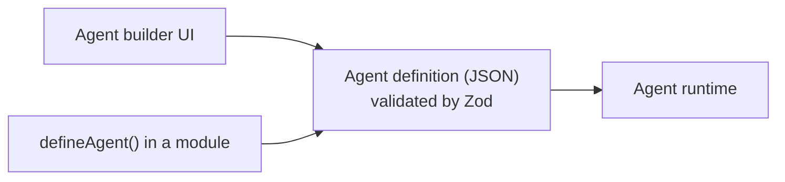
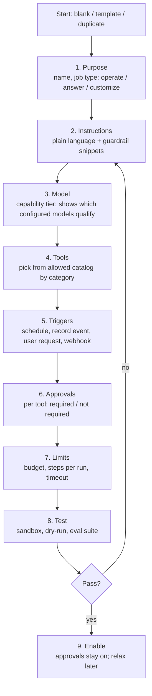
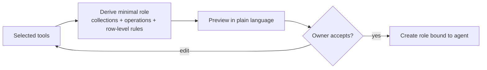
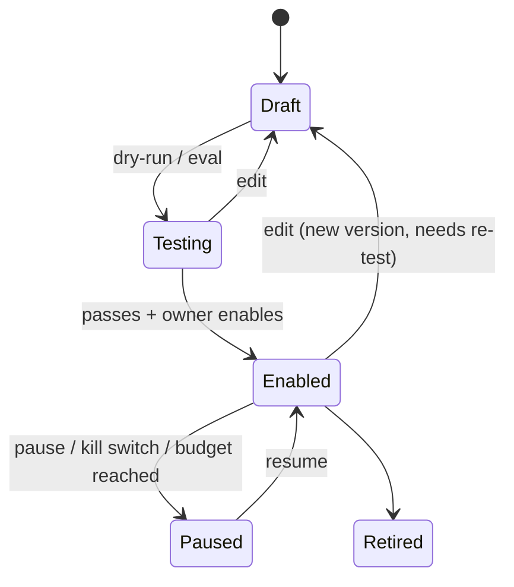
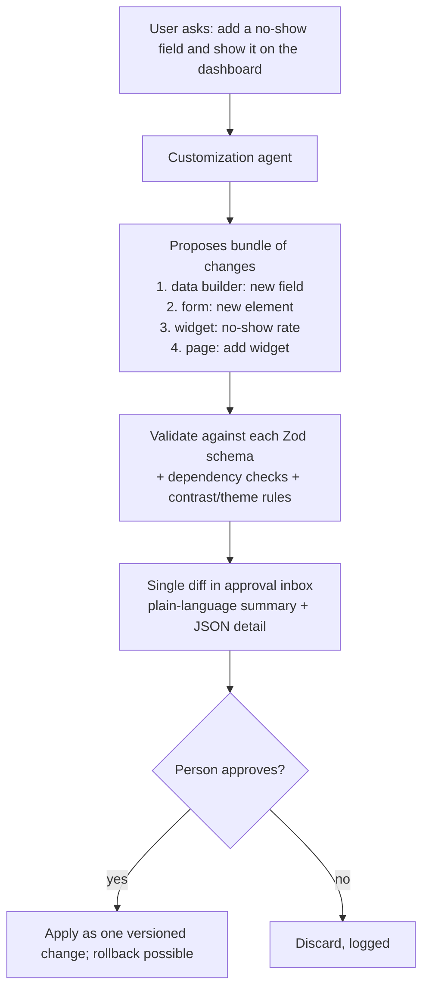

# 23. Agent builder

> **Status: proposed.** This is the no-code UI for the agent definitions described in [doc 07](07-agents.md). The runtime, tool categories and safety rules there are decided; this doc defines the builder on top of them.

## Goal

Let a business owner or builder create, test and safely enable an agent without writing the `defineAgent` code by hand, while the output is exactly the same declarative definition developers would write.

## What the builder produces



UI-built and code-defined agents are the same data, so they can be exported, diffed, packaged in bundles and proposed by other agents.

## Builder steps



### Step details

| Step | What the builder shows and enforces |
| --- | --- |
| Purpose | A job type that sets sensible defaults: *answer* agents get read-only tools only |
| Instructions | Text editor with templates, a library of guardrail snippets ("Never promise refunds", "Ask before cancelling"), and a warning if it tries to grant permissions or override rules in prose (those are ignored by the runtime) |
| Model | Capability tier picker. Lists configured models with their capability profile ([doc 08](08-sovereign-ai-and-model-gateway.md)); blocks models that do not meet the agent's minimum |
| Tools | Catalog grouped by Read, Write, Configuration, Outbound. **Administration tools do not appear.** Tool scopes are narrowed (for example `bookings.list` restricted to future bookings) |
| Triggers | Schedule picker (human-readable cron), record event picker (collection and condition), user request (button or chat), incoming webhook |
| Approvals | Defaults to required for outbound and configuration; the owner can relax per tool with an explicit warning |
| Limits | Monthly budget (for public models), max steps, timeout; local models show usage but no cost |

## The agent's role

The builder creates a **dedicated least-privilege role** for each agent, derived from the selected tools. The builder shows the effective permissions in plain language:

> This agent can read bookings and contacts (all fields except those tagged *payment*) and send email. It cannot edit bookings.



The agent never inherits the permissions of the person who built or triggered it.

## Testing in the builder

| Test | Purpose |
| --- | --- |
| **Playground** | Chat or trigger the agent with sample input; see each step, tool call and result |
| **Dry-run on real data** | Write and outbound tools are recorded, not executed; review the proposed actions |
| **Eval suite** | Saved test cases: expected tool calls, expected refusals. Includes built-in cases for prompt injection, budget exhaustion and tool misuse |
| **Model comparison** | Run the same cases on two models to choose the smallest that passes |
| **Replay** | Re-run a past run with a changed instruction to see the difference |

```mermaid
sequenceDiagram
    participant B as Builder
    participant PG as Playground / dry-run
    participant RT as Runtime (dry-run flag)
    participant GW as Gateway
    B->>PG: Provide sample input or pick real records
    PG->>RT: Start run with dry-run = true
    RT->>GW: Model call
    GW-->>RT: Tool calls
    RT-->>PG: Reads executed; writes/outbound recorded only
    PG-->>B: Timeline: reasoning summary, calls, would-be effects
    B->>PG: Save case to eval suite (expected behaviour)
```

**Enabling is gated:** the builder will not enable an agent until at least one dry-run has been reviewed and its eval suite passes on the selected model.

## Monitoring and operations

After enabling, the builder doubles as the management console:

- **Runs list** with status, duration, tokens, cost, outcome
- **Run detail:** every prompt (as sent after tag stripping), tool call, result and approval
- **Pending approvals** for this agent
- **Usage vs budget** chart
- **Pause / resume** per agent; global kill switch ([doc 07](07-agents.md))
- **Alerts** for failures, budget thresholds, repeated rejections (a sign the instructions need work)
- **Version history** of the definition with diff and rollback



Editing an enabled agent creates a new version that must pass its tests again before replacing the live one.

## Using the agent builder to customize the other builders

The **customize** job type is how agents change the app. It uses configuration tools whose output is a diff:



Because forms, pages, widgets and themes are all validated configuration, the agent can propose changes across all of them in one reviewable change set. Only models that pass the customization eval get free-form mode; others get **guided templates** (fill-in-the-blank requests such as "add field to collection").

## Templates and packs

- Starter templates per job type (reminder, follow-up, summarizer, data-entry helper, report writer)
- **Agent packs** ship inside bundles with eval suites attached; importing a pack imports its tests
- Export and import as JSON; imported agents arrive **disabled, with approvals on**

## Permissions and seats

| Action | Needs |
| --- | --- |
| Create, edit, test agents | `builder.agent` (builder seat) |
| Enable an agent | `builder.agent` + `builder.publish`; owner approval setting can require a second person (paid advanced edition) |
| Relax an approval rule | Owner only |
| Raise a budget | Owner only |
| Anything involving administration tools | Not possible |

## Tests

- Agent role derived from tools never exceeds the union of the tool requirements.
- Prose in instructions cannot add permissions.
- Enabling is blocked without passing evals on the chosen model.
- Imported agents arrive disabled.
- A customization proposal that fails any schema, dependency or accessibility check never reaches the approval inbox as applicable.

## Roadmap placement

Builder UI lands in **Phase 4** with the runtime, with a minimal JSON editor earlier for internal testing. See [doc 15](15-module-plan-and-roadmap.md).
