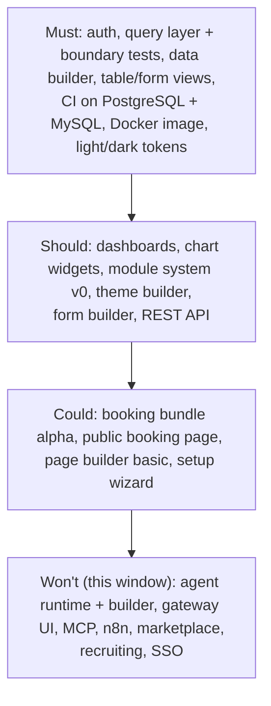
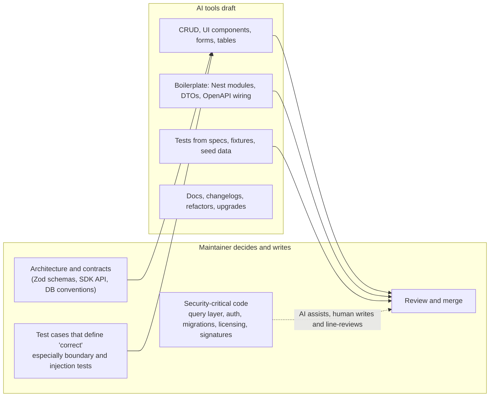
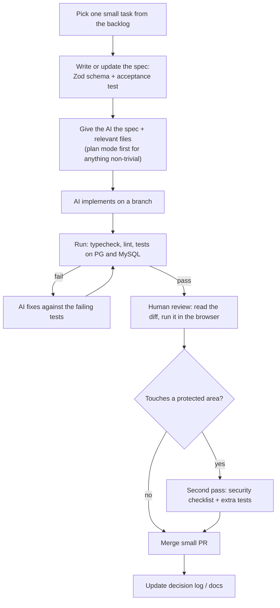

# 24. Three-month plan (AI-assisted)

> **Status: proposed.** Covers 9 Nov 2026 to 5 Feb 2027 (13 weeks), starting the Monday after these docs were written. It slices the long-range phases in [doc 15](15-module-plan-and-roadmap.md) into what one maintainer, working with AI coding tools, can realistically ship.

## Assumptions (change these first)

| Assumption | Value | If wrong |
| --- | --- | --- |
| People | One maintainer, no hires | More people: pull Month 3 items forward |
| Focused hours | About 25 per week, around 325 total | Fewer hours: cut from the bottom of the "scope ladder" below |
| AI tools | Claude Code, Cursor or Codex available daily | See the workflow section |
| Holidays | Reduced capacity 21 Dec to 3 Jan (about half) | Already reflected in the schedule |
| Hardware | One machine able to run small local models via Ollama | Needed for the model spike |
| Validation | Interviews run in parallel, 2 to 3 calls per week | Without them, the booking scope is a guess |

## What "done in 3 months" means

Realistic target: **an installable alpha of the free base plus an early booking bundle, running on both databases, with the theme (light/dark) and form builders working, and a first agent proven in a spike.**

The full agent runtime, the agent builder UI, MCP and n8n are **not** in this window. They are Phase 4 ([doc 15](15-module-plan-and-roadmap.md)). Promising them in 13 weeks would repeat the "scope is four products at once" risk ([doc 16](16-risks-and-open-decisions.md)).

### Scope ladder (cut from the bottom first)



## Timeline

```mermaid
gantt
    title Dashground, 9 Nov 2026 to 5 Feb 2027
    dateFormat YYYY-MM-DD
    axisFormat %d %b
    section Month 1: Prove and lay foundations
    Repo, CI (PG + MySQL), tooling, AI rules   :m1a, 2026-11-09, 7d
    Spike: runtime module install on NestJS    :m1b, 2026-11-16, 7d
    Spike: Kysely vs Drizzle                   :m1c, 2026-11-23, 7d
    Auth, sessions, roles                      :m1d, 2026-11-16, 14d
    Query layer + boundary tests               :m1e, 2026-11-23, 14d
    Interviews and competitor notes            :m1f, 2026-11-09, 28d
    section Month 2: Core product
    Data builder + staged migrations           :m2a, 2026-12-07, 21d
    Views: table, form, kanban, calendar       :m2b, 2026-12-14, 21d
    Spike: dashboard grid and view builder     :m2c, 2026-12-07, 7d
    Theme tokens, light/dark                   :m2d, 2026-12-14, 14d
    Docker image + Compose                     :m2e, 2026-12-28, 7d
    Spike: local models via Ollama             :m2f, 2026-12-28, 7d
    section Month 3: Builders and booking alpha
    Dashboards + widgets                       :m3a, 2027-01-04, 14d
    Module system v0 + REST API                :m3b, 2027-01-04, 21d
    Form builder + theme builder UI            :m3c, 2027-01-11, 14d
    Booking bundle alpha                       :m3d, 2027-01-18, 14d
    Alpha release + gate review                :milestone, m3e, 2027-02-05, 1d
```

## Week-by-week plan

Weeks run Monday to Friday. "Exit" is what must be true to move on.

### Month 1 (9 Nov to 4 Dec): prove the risky bets, build the spine

| Week | Focus | Deliverables | Exit |
| --- | --- | --- | --- |
| 1 (9 Nov) | Repo and rails | pnpm + Turborepo monorepo, TypeScript strict, lint, test runner, CI on **PostgreSQL 16 and MySQL 8.4**, `CLAUDE.md`/`AGENTS.md` rules, PR template, commit conventions | A trivial test passes on both databases in CI |
| 2 (16 Nov) | Spike A and auth | **Module runtime spike** (install and remove a module on NestJS). Begin auth: Argon2id, cookie sessions, CSRF | Spike has a written pass or fail. Login works |
| 3 (23 Nov) | Spike B and query layer | **Kysely vs Drizzle** on both databases, including a staged schema change. Start the query layer (`site_id`, role CRUD) | Query library chosen and recorded |
| 4 (30 Nov) | Query layer and boundary tests | Row-level rules, **cross-role and cross-site test suite** on both databases | Suite green. Decision log updated. **Checkpoint 1** |

Parallel all month: 2 to 3 interviews per week (booking businesses and sovereignty-minded companies); notes on NocoBase, Budibase, Appsmith, Dify, Flowise, n8n.

**Checkpoint 1 (4 Dec):** if the module spike failed, switch to the Next.js fallback now, re-plan Month 3 (install becomes a rebuild step), and say so in [doc 16](16-risks-and-open-decisions.md).

### Month 2 (7 Dec to 1 Jan): the core product

| Week | Focus | Deliverables | Exit |
| --- | --- | --- | --- |
| 5 (7 Dec) | Data builder part 1, grid spike | Collections and fields, `app_` tables, soft delete. **Dashboard grid spike** (build vs adopt) | Create a collection from the UI. Grid decision recorded |
| 6 (14 Dec) | Data builder part 2, views, tokens | Relations, expand/backfill/contract migrations with preview and backup. Table and form views. **Theme tokens and light/dark** across the first components | Staged change survives a forced mid-way failure on both databases |
| 7 (21 Dec) | Views (half week) | Kanban, calendar, detail. Zod schemas for view config | Views render for a seeded collection |
| 8 (28 Dec) | Packaging and Ollama spike (half week) | Dockerfile, Compose, one-port server serving admin UI. **Ollama spike** on the booking reminder task with 3 to 4 models | A stranger can run `docker compose up -d`. Spike notes written (tool calling, structured output) |

**Checkpoint 2 (1 Jan):** is the data builder safe? If staged migrations are not solid on MySQL, stop adding features and fix; everything else reads this layer.

### Month 3 (4 Jan to 5 Feb): builders, extensibility, booking alpha

| Week | Focus | Deliverables | Exit |
| --- | --- | --- | --- |
| 9 (4 Jan) | Dashboards and widgets | Dashboard page (grid, shared filters, versioning), built-in widgets (number, charts, table, list) with access-scope-aware caching | A dashboard shows data different roles see differently |
| 10 (11 Jan) | Module system v0 and API | `defineModule`, lifecycle (install to purge), backup and smoke check. REST API with scoped tokens, OpenAPI from Zod | Install and remove a declarative module on both databases |
| 11 (18 Jan) | Form builder and theme builder | Drag-and-drop form builder with validation and conditional logic. Theme builder UI with contrast checks and presets | Build a form and re-theme the app, light and dark, with no code |
| 12 (25 Jan) | Booking bundle alpha | Booking collections, calendar, form, dashboard, confirmations by email, built with the bundle manifest | A booking flows from form to calendar to dashboard |
| 13 (1 Feb) | Harden and release | Setup wizard (no AI step), docs pass, security checklist from [doc 10](10-security.md), alpha tag, demo video | **Gate review (5 Feb)**, below |

### Gate review, 5 Feb 2027

| Question | Pass looks like |
| --- | --- |
| Does it install for a stranger? | 3 people (not you) install from the docs in under 15 minutes |
| Is the data boundary real? | Boundary suite green on PostgreSQL and MySQL |
| Is booking wanted? | At least 1 of 3 interviewed businesses agrees to try the alpha |
| Is AI worth the effort? | Ollama spike shows at least one local model handles the reminder task acceptably |
| Is the pace real? | Compare actual hours and completed scope with this plan, then re-plan Phase 4 |

## AI-assisted coding workflow

One maintainer plus AI tools is the plan, so the workflow has to protect quality. Principle: **AI writes volume, the maintainer owns the contracts and the risky parts.**

### Division of labor



| Work type | AI role | Human rule |
| --- | --- | --- |
| Schemas and contracts | Suggests | Human writes first; everything else derives from them |
| Query layer, auth, sessions, CSRF | Reviewer and test generator only | Human-written, line by line review, extra tests |
| Migrations and schema builder | Drafts | Must pass the forced-failure test on both databases before merge |
| Licensing and signature code | Reviewer only | Human-written, ideally an external review |
| UI components, views, builders | Primary author | Reviewed in the browser, not only in the diff |
| Tests | Drafts from specs | Human adds the adversarial cases |
| Docs | Primary author | Human checks claims against code |

### Daily loop



### Rules to put in `CLAUDE.md` / `AGENTS.md` from week 1

1. **Schema first.** New configuration shapes start as a Zod schema in `packages/schemas`; never invent JSON shapes in components.
2. **All data access goes through the query layer.** No direct Kysely or driver calls in feature code. Lint rule enforces it.
3. **Both databases.** Any SQL or migration change must run on PostgreSQL and MySQL in CI.
4. **No raw SQL tool for agents, no raw CSS or HTML in builders.** Configuration only.
5. **No new dependency without a reason** recorded in the PR (supply-chain risk, bus factor).
6. **Small PRs, one concern each**, with the tests that prove it.
7. **Never weaken or delete a test to make it pass.** Report instead.
8. **Do not touch protected paths** (`packages/query`, auth, migrations, licensing) without an explicit instruction from the maintainer.
9. **Keep docs in step.** A PR that changes a decision updates the relevant doc and the decision log.
10. **Secrets never enter prompts or fixtures.**

### Tooling guidance

| Tool | Good for |
| --- | --- |
| Claude Code (terminal/IDE) | Multi-file changes, planning, running test loops, reviews, docs |
| Cursor | Fast in-editor UI work and refactors |
| Codex | Parallel background tasks on well-specified tickets |
| MCP server (from Phase 2) | Dogfooding: use our own module scaffolding with AI tools |

Practical habits: use plan mode before large changes; keep tasks small enough to review in one sitting; give the AI the failing test, not a vague description; run independent tasks (for example docs, fixtures, a UI component) in parallel branches; use a separate review pass (`/code-review`, `/security-review` or a second tool) on every protected-path change.

### AI-specific risks and countermeasures

| Risk | Countermeasure |
| --- | --- |
| Plausible but wrong SQL or migrations | Forced-failure and dual-database tests are the merge gate |
| Security holes in generated auth or access code | Human-written protected paths; boundary suite; independent review before 1.0 |
| Hallucinated packages or APIs | Lockfile review; dependency scan in CI; no auto-added dependencies |
| Architecture drift across many AI-written files | Contracts in `packages/schemas`; lint rules; weekly 30-minute architecture check against these docs |
| Maintainer loses understanding of the code | Rule: no merge of code you could not explain; weekly "read a random module" session |
| Over-building because AI makes code cheap | The scope ladder and the gate review decide what is built, not what is easy |
| Test suites that assert what the AI wrote, not what is right | Maintainer writes the adversarial and acceptance tests first |
| Licensing or copyright uncertainty of generated code | Record tools used; keep a human-authored core for protected areas; take legal advice before selling bundles (see [doc 16](16-risks-and-open-decisions.md)) |

## Metrics to track weekly

| Metric | Why |
| --- | --- |
| Hours worked vs 25 planned | Calibrates every future estimate |
| Scope items done vs planned | Shows velocity, including the AI effect |
| Boundary and migration tests: count and pass rate | Core safety signal |
| Time from clone to running install | Adoption friction |
| Interviews held and positive signals | Demand evidence |
| Share of merged code reviewed line by line | Guards against rubber-stamping |
| Escaped bugs found after merge | Tells whether the review loop works |

## What to do if behind

1. Drop from the bottom of the scope ladder: page builder, public booking page, setup wizard, theme builder UI.
2. Keep Must items and boundary tests untouched. They cannot slip.
3. Ship the alpha with fewer features rather than later. The gate review is a learning event, not a deadline to hit.
4. Record the cause (hours, scope, tooling) and adjust Phase 4 timing.

## What happens next (months 4 to 6, outline only)

Agent runtime and tool registry, model gateway with Ollama, approval inbox and dry-run, booking reminder agent with evals, air-gapped mode and egress report, then the agent builder UI ([doc 23](23-agent-builder.md)). Detailed planning happens at the 5 Feb gate review, using real velocity numbers.
