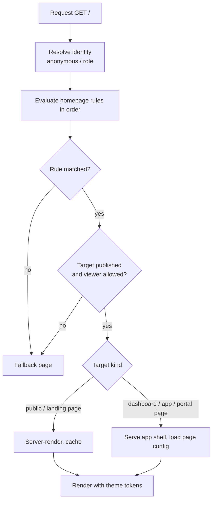
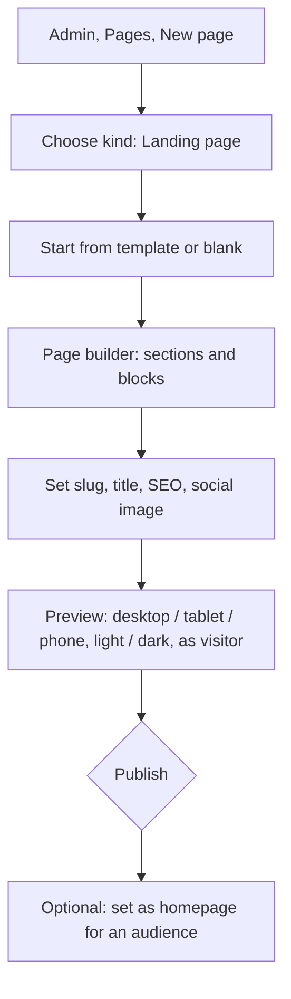
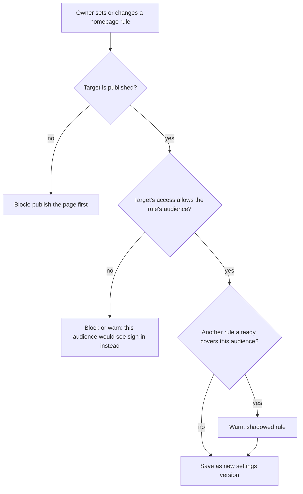
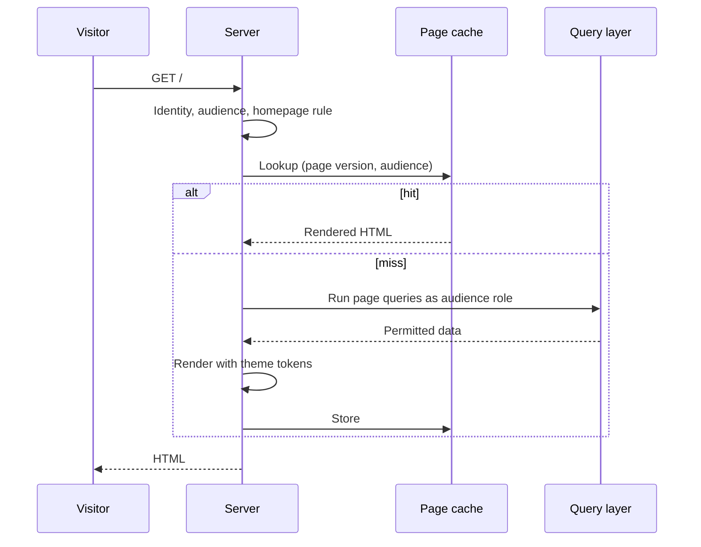

# 25. Landing pages and homepage setting

> **Status: proposed.** Builds on the page builder ([doc 21](21-page-builder.md)). Public pages already exist there; this doc defines how a user creates landing pages in the admin panel and chooses what the site's main page (`/`) shows.

## Goal

1. Users create **pages**, including **landing pages**, in the admin panel.
2. Users choose a **default page for the homepage**. It can be a **dashboard** or a **landing page**.
3. The choice can differ by **who is visiting**: for example, visitors see a landing page and signed-in staff see their dashboard.

## Concepts

| Term | Meaning |
| --- | --- |
| **Landing page** | A public (or portal) page built with the page builder, with SEO fields and a call to action. Marketing-style content: hero, features, pricing, booking form |
| **Dashboard** | A page in grid mode for signed-in users ([doc 21](21-page-builder.md)) |
| **Homepage** | Whatever `/` resolves to for a given visitor |
| **Homepage rule** | One row in the homepage setting: *audience* then *target page* |

A landing page is not a new kind of page. It is a **public page with landing-page defaults and templates**, so there is still only one page system.

## Homepage setting

Found in **Admin, Settings, Homepage**. It is an ordered list of rules; the first match wins.

| # | Audience | Target (example) |
| --- | --- | --- |
| 1 | Signed-in, role `owner` or `staff` | Dashboard: "Today" |
| 2 | Signed-in, role `customer` | Portal page: "My bookings" |
| 3 | Anyone else (anonymous) | Landing page: "Welcome" |
| fallback | Always last | The built-in sign-in page, or a system "Not configured" page |

Simple mode (default): **one target for everyone**, picked from a dropdown. Advanced mode: the rule list above.

```json
{
  "homepage": {
    "mode": "rules",
    "rules": [
      { "audience": { "roles": ["owner", "staff"] }, "page": "page_dashboard_today" },
      { "audience": { "roles": ["customer"] },       "page": "page_portal_my_bookings" },
      { "audience": { "anonymous": true },           "page": "page_landing_welcome" }
    ],
    "fallback": "system:login"
  }
}
```

Validated by Zod like all other configuration.

## Routing: what happens at `/`



Notes:

- **No redirect by default.** `/` serves the target's content directly, so the address bar stays `/`. An option can switch to a redirect (301/302) to the page's own slug, useful when a page also lives at a canonical URL.
- The target page still passes its own **access check and the query layer**. Setting a dashboard as homepage for anonymous visitors cannot expose data; it would show the sign-in page, because the audience check fails.
- Pages stay reachable at their own slug (`/welcome`, `/dashboard/today`) regardless of homepage choice.

## Creating a landing page



### Templates (starter set)

| Template | Sections |
| --- | --- |
| Simple welcome | Hero, three feature cards, call to action, footer |
| Booking business | Hero, services list (from the data), booking form, opening hours, map embed (allowlisted), testimonials |
| Recruiting agency | Hero, open roles list (from the data), application form, how it works |
| Portal entry | Sign-in prompt, quick links, support contact |

Bundles can ship their own landing templates, installed along with the bundle ([doc 06](06-modules-and-bundles.md)).

### Landing-page blocks

On top of the standard blocks in [doc 21](21-page-builder.md):

- Hero (headline, subtext, image/video, buttons)
- Feature grid, steps, FAQ (accordion), testimonials, logo strip
- Pricing table (static or bound to a collection)
- **Data list** (for example "services" or "open roles", read through the public role)
- **Form block** (booking request, contact, application), from the form builder ([doc 20](20-form-builder.md))
- Header and footer **shared sections** (edit once, used on every page)
- Language/theme switcher, cookie-notice block

## Page management screen

**Admin, Pages** lists every page with filters.

| Column | Meaning |
| --- | --- |
| Title and slug | `/welcome` |
| Kind | Landing, public, dashboard, app, portal |
| Status | Draft, Published, Scheduled, Archived |
| Audience | Public, signed-in, specific roles |
| Homepage badge | Shown if it is the homepage for any audience |
| Updated / by | Last editor |

Actions: create, duplicate, preview, publish/unpublish, schedule, archive, set as homepage, view version history, delete (with dependency check).

## Guard rails for the homepage



| Situation | Behavior |
| --- | --- |
| Delete or unpublish the current homepage target | **Blocked** until another target is chosen, or the fallback is accepted explicitly |
| Target page edited into an invalid state | Last valid published version keeps serving |
| No rule matches | Fallback page; never a blank or error screen |
| Setting changed | Versioned; one-click rollback; logged in the audit log |
| Who can change it | `builder.page` plus `builder.publish`; the paid edition can require approval |

## Publishing, scheduling and caching

- **Draft, publish, rollback** follow the shared lifecycle in [doc 18](18-builder-studio-overview.md).
- **Scheduled publish**: set a go-live (and optional end) time; useful for campaigns. A schedule can also swap the homepage at a set time ("holiday landing page from 1 Dec").
- **Caching:** public/landing pages are rendered on the server and cached; the cache is invalidated on publish or on a change to data the page lists. Cache keys include the **audience**, so a signed-in view of `/` never serves to an anonymous visitor.



## SEO and sharing (public and landing pages)

- Title, meta description, canonical URL, language
- Open Graph/Twitter image and text
- `robots` setting per page (index / noindex); drafts and portal pages are always `noindex`
- Auto-generated `sitemap.xml` from published public pages; `robots.txt` managed in settings
- Clean slugs with redirect history when a slug changes
- Structured data for common cases (organization, local business, job posting) from block settings

## Slugs and reserved paths

Reserved prefixes can never be used as page slugs: `/admin`, `/api`, `/auth`, `/login`, `/portal`, `/assets`, `/_`, and any module-registered route. The builder validates slugs at save time and shows a conflict message. Module routes cannot silently override a published page: the module installer reports the clash and blocks activation.

## Security

| Risk | Control |
| --- | --- |
| A public landing page exposes private data through a data block | Data blocks on public pages run as the public role only; the builder warns when a block binds to something that role cannot read |
| Setting a dashboard as the homepage for everyone | Audience check applies; anonymous users get the sign-in page, never dashboard data |
| Stored XSS in landing content | Sanitized rich text with an allowlist; no raw HTML or script blocks; strict CSP |
| Open redirect via homepage redirect option | Redirect targets are page IDs, never arbitrary URLs |
| Spam through landing forms | Rate limits, honeypot, optional self-hosted captcha ([doc 20](20-form-builder.md)) |
| Tracking scripts leaking visitor data | No analytics scripts by default; an allowlisted embed block, off in air-gapped mode |
| Slug collisions with system routes | Reserved-prefix validation |
| Homepage hijack by an agent | Agents can only **propose** a homepage change as a diff; it needs a person's approval |

## Free vs paid (proposed)

| Capability | Free base | Paid |
| --- | --- | --- |
| Create and publish pages, set one homepage target | Yes | |
| Landing page templates (starter set) | Yes | |
| Role-based homepage rules | Yes | |
| Scheduled homepage swaps, A/B variants | | Later, paid |
| Custom domain per portal or microsite, white-label | | Paid (white-labelling is already a paid feature) |
| Vertical landing templates inside bundles | | With the bundle |

## Agent integration

An agent (customize job, [doc 07](07-agents.md)) can draft a landing page from instructions ("a page for our new massage service with the booking form") and propose it through the configuration tool. The page arrives as a **draft** with a diff and an approval request. Changing the homepage setting is a separate, explicit approval.

## Tests

- `/` resolves to the right target for anonymous, customer, staff and owner.
- Unpublishing or deleting the active target is blocked.
- Anonymous request to `/` with a dashboard target never returns dashboard data.
- Cached anonymous HTML is never served to a signed-in user, and vice versa.
- Reserved slugs are rejected; module route clashes block activation.
- Scheduled publish and swap fire at the right time and roll back cleanly.

## Roadmap placement

- **Phase 1:** a fixed homepage (dashboard for signed-in users, sign-in for others).
- **Phase 2/3:** page management screen, landing page kind, templates, homepage rules, SEO fields. Required for the booking bundle, which needs a public landing page with a booking form.
- **Later:** scheduling, variants and custom domains.

In the 3-month plan ([doc 24](24-three-month-plan.md)) this lands in week 12 as a "Could" item, together with the public booking page. If the schedule slips, the single-target homepage dropdown ships first and the role-based rules follow.
