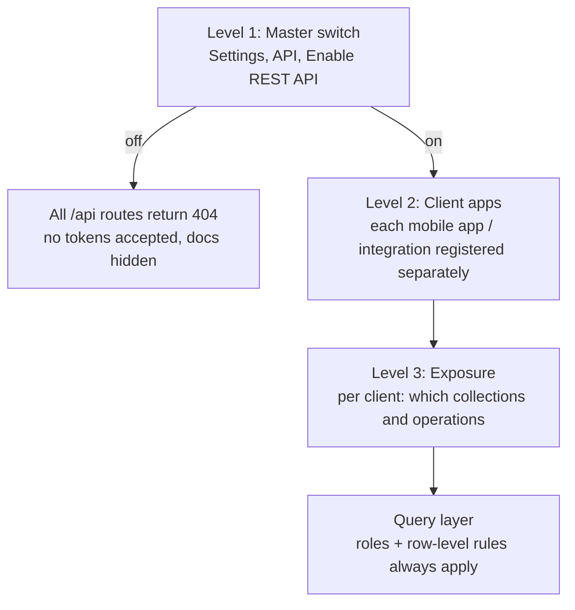
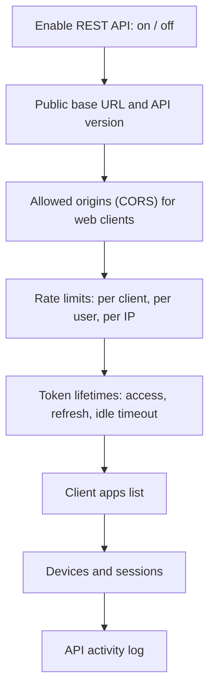
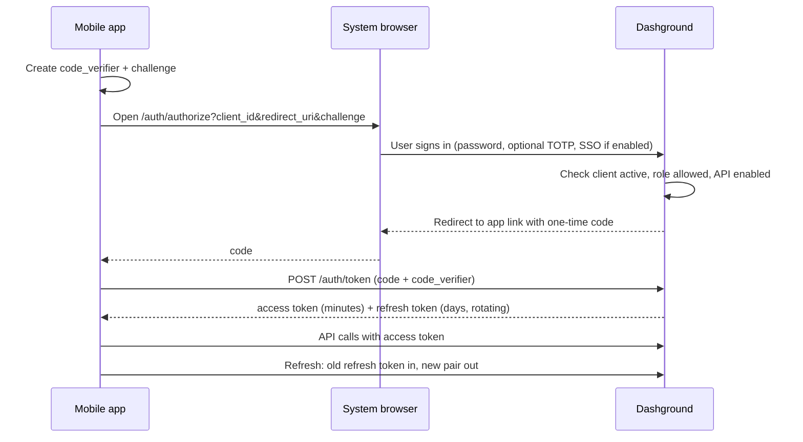
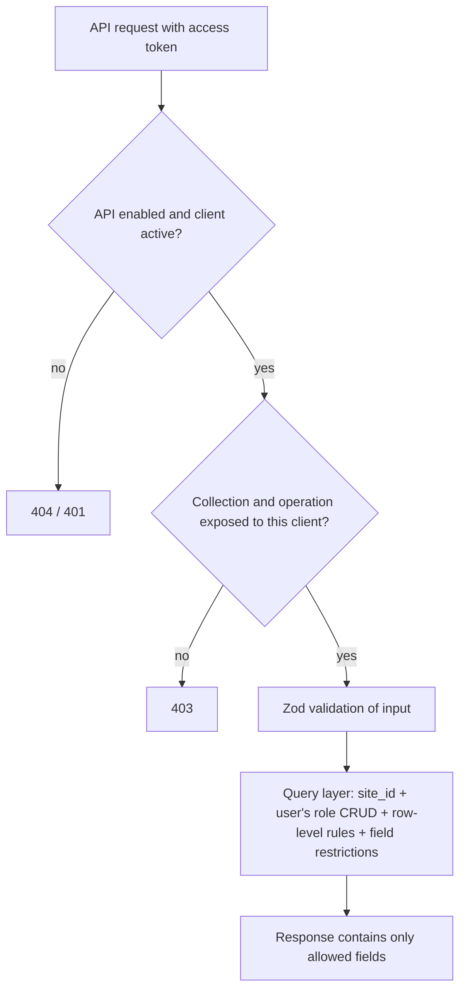

# 26. REST API switch and mobile app access

> **Status: proposed.** Extends the REST API in [doc 09](09-integrations.md). That doc covers scoped tokens for scripts and tools. This doc adds an **owner-controlled on/off switch** and the pieces a **mobile app** needs: user sign-in with tokens, registered app clients, per-collection exposure and device management.

## Goal

An owner can choose, from the admin panel, whether the install exposes a REST API for mobile apps (and other clients) at all. When it is off, the API does not exist from the outside. When it is on, the owner decides exactly what it exposes and to whom.

## The switch has three levels



| Level | Control | Default |
| --- | --- | --- |
| 1. Master | Enable or disable the REST API for the whole install | **Off** (secure by default; the admin UI does not use the public API surface) |
| 2. Client | Register, pause or revoke each client app (e.g. "Customer app", "Staff app") | None registered |
| 3. Exposure | Per client: allowed collections, operations (read, create, update, delete), actions and fields | Nothing exposed until chosen |

Decision: **off by default.** It follows the sovereign, least-exposure positioning ([doc 08](08-sovereign-ai-and-model-gateway.md)). The setup wizard asks once ("Will you connect a mobile app?") and the answer can be changed any time.

The switch covers the **public API**. The admin UI keeps using its own internal, cookie-protected endpoints, so turning the API off never breaks the web app.

## What "off" really means

| Aspect | Behavior when disabled |
| --- | --- |
| Routes | `/api/*` returns 404 (not 401, so its existence is not advertised) |
| Tokens | Existing tokens stop working immediately; they are kept (not deleted) so re-enabling restores them unless the owner revokes |
| OpenAPI docs and explorer | Hidden |
| Webhooks | Unaffected; they are outbound ([doc 09](09-integrations.md)) |
| Agents | Unaffected; they use internal tools, not the HTTP API |
| Egress / air-gapped | Unaffected; the API is inbound only |
| Audit | Enabling, disabling and every client change are logged |

## Settings screen (Admin, Settings, API)



Turning the switch **off** asks for confirmation and shows how many clients and active devices will lose access. Turning it **on** shows a checklist: HTTPS configured, `APP_URL` set, rate limits reviewed.

## Client apps (registered integrations)

Each mobile app or integration is a **client** with its own identity, so access can be limited and revoked without affecting others.

| Field | Meaning |
| --- | --- |
| Name and type | "Customer app", type `mobile` / `server` / `web` |
| Client ID | Public identifier. Mobile apps are **public clients**: they have no secret, because a secret inside an app can be extracted |
| Redirect URIs / app links | Allowed return targets for sign-in (used by the PKCE flow below) |
| Allowed roles | Which user roles may sign in through this client (for example only `customer`) |
| Exposure | Collections, operations, actions and fields exposed ([below](#exposure-what-a-client-can-touch)) |
| Limits | Rate limits and token lifetimes, overriding the defaults |
| Status | Active, paused, revoked |

Server-to-server integrations (scripts, n8n) use **scoped API tokens** as in [doc 09](09-integrations.md). Mobile apps use **user sign-in**, described next.

## Mobile sign-in

Cookie sessions suit browsers but not native apps, so mobile clients use **short-lived access tokens with rotating refresh tokens**, obtained through an authorization-code flow with **PKCE**.



Rules:

- **Access token:** short-lived (default 15 minutes), carries user, role, client and device; never contains data.
- **Refresh token:** rotating (each use issues a new one and invalidates the old). If an old one is reused, the whole token family is revoked, since it may be stolen.
- **Device records:** each sign-in creates a device entry (name, OS, last used, IP range). Users see and revoke their own devices; owners see all.
- **Storage guidance for app developers:** tokens go in the platform's secure store (iOS Keychain, Android Keystore), never plain storage.
- **Logout:** revokes the refresh token server side.
- **Password change or role change:** revokes the user's tokens.
- Optional **TOTP** and **biometric unlock** (local to the app, gating use of the stored token) are supported; the server's authority is still the token.
- No password grant for third-party apps: users always sign in on the server's own page.

## Exposure: what a client can touch

The API is **opt-in per collection**. A collection is invisible to a client until the owner exposes it, and then only for the chosen operations and fields.



Two gates, both must pass: the **client exposure** (what this app may ask for) **and** the **user's role** (what this person may see). Exposure can only narrow access, never widen it. A customer app that exposes `booking` still shows each customer only their own bookings, through the row-level rule "only records where customer is me".

### Exposure configuration (illustrative)

```json
{
  "client": "customer-app",
  "allowedRoles": ["customer"],
  "collections": {
    "booking": { "ops": ["read", "create", "update"], "fields": ["service", "starts_at", "status", "notes"] },
    "service": { "ops": ["read"] }
  },
  "actions": ["booking.cancel"],
  "forms": ["booking-request"]
}
```

Field tags (for example `personal-data`) are respected: tagged fields can be excluded from a client entirely.

### Presets

To avoid hand-building every client, the owner can start from presets, then adjust:

| Preset | Exposes |
| --- | --- |
| Customer app | The customer's own records, public services, booking form and cancel action |
| Staff app | Staff-visible collections with staff role rules |
| Read-only reporting | Read on selected collections and dashboards' saved queries |
| Custom | Start empty |

Bundles can ship client presets (the booking bundle ships "Customer booking app") that the owner reviews before enabling.

## Endpoints (v1 outline)

| Group | Examples |
| --- | --- |
| Auth | `GET /auth/authorize`, `POST /auth/token`, `POST /auth/revoke`, `GET /auth/me` |
| Records | `GET /api/v1/{collection}`, `GET /api/v1/{collection}/{id}`, `POST`, `PATCH`, `DELETE` |
| Query | Filtering, sorting, field selection, pagination (cursor based), relation expansion |
| Actions | `POST /api/v1/actions/{name}` for declared actions (for example `booking.cancel`) |
| Forms | `GET /api/v1/forms/{id}` (schema), `POST /api/v1/forms/{id}/submit` ([doc 20](20-form-builder.md)) |
| Files | Signed upload and download URLs |
| Meta | `GET /api/v1/schema` (only what the client may see), `GET /api/v1/openapi.json` |
| Devices | `POST /api/v1/devices` (register push token, later), `GET/DELETE /api/v1/devices` |

Conventions:

- Versioned path (`/api/v1`). Breaking changes only in a new version; the previous one is supported for a stated period.
- Cursor pagination, ISO timestamps in UTC, consistent error shape (`code`, `message`, `fields[]`).
- Idempotency keys on create and action requests, so flaky mobile connections can safely retry.
- `ETag`/`If-Match` on updates to detect conflicting edits.
- `OpenAPI` generated from the same Zod schemas, filtered per client, so app developers get accurate client libraries ([doc 11](11-tech-stack-and-database.md)).
- Field-level data that the data builder changes (new field, renamed field) shows up in the schema endpoint; deprecated fields stay for the version's lifetime.

## Offline and sync (outline, later)

Mobile apps often work offline. Phase one gives the building blocks only: `updated_at`, `deleted_at` (soft deletes are already standard, [doc 04](04-data-builder.md)), cursor "changes since" queries and ETags. A full sync protocol is a later decision and listed in the open questions.

## Push notifications (open)

Push needs a provider (APNs, FCM) that sends data through third-party servers, which conflicts with air-gapped and sovereign installs. Proposed: the API stores device push tokens, but sending is an optional **notification module** that the owner enables and whose destinations appear in the egress report ([doc 09](09-integrations.md)). Not part of the first release.

## Security

| Risk | Control |
| --- | --- |
| API exposed when not wanted | Off by default; 404 when off; explicit enable with checklist |
| Stolen mobile token | Short access tokens, rotating refresh with reuse detection, per-device revoke, revoke on password or role change |
| Secret extracted from an app | Public clients with PKCE; no embedded secrets |
| Over-exposure of data | Opt-in per collection and field; exposure only narrows; query layer still enforces roles and row-level rules |
| Brute force and scraping | Rate limits per IP, user and client; lockout and backoff on sign-in; pagination caps |
| Mass assignment | Only exposed fields are accepted on writes (same rule as public forms) |
| Injection | Zod validation, parameterized queries |
| CORS abuse | Explicit allowed-origins list; no wildcard with credentials |
| Replay of retried requests | Idempotency keys; short-lived tokens; HTTPS only (HSTS) |
| Insecure transport | The API refuses plain HTTP outside localhost |
| Abuse by a compromised client app | Pause or revoke the client in one click; all its tokens die |
| Noisy logs leaking data | API log stores metadata (who, what, when), not payloads, by default |
| Agents bypassing | Agents never use this API; they use internal tools with their own role |

## API activity log and monitoring

Admin, Settings, API, Activity shows requests by client, user, endpoint, status and latency, with filters, plus error rate and rate-limit hits. Alerts for unusual patterns: sign-in failures, refresh-token reuse, a sudden spike on one client. Retention follows the owner's settings.

## Licensing and plan (proposed)

| Capability | Free base | Paid |
| --- | --- | --- |
| Enable/disable REST API, scoped tokens, OpenAPI | Yes | |
| Mobile sign-in (PKCE), client apps, devices | Yes | |
| Client presets from bundles | With the bundle | |
| SSO for mobile sign-in, audit export, per-client SLA metrics | | Advanced edition |

End users of a mobile app are not seats (only builders are, [doc 14](14-pricing-and-monetization.md)). The owner who configures clients and exposure is a builder.

## Tests

- With the switch off, every `/api` route and the docs return 404; with it on, they work; no restart needed.
- A collection that is not exposed returns 403 for every operation and does not appear in the schema endpoint.
- Exposure cannot grant access the user's role lacks (customer cannot read another customer's booking).
- Reusing an old refresh token revokes the family.
- Password change revokes all of the user's tokens.
- Over-posted fields are rejected.
- Rate limits trigger and recover.
- The same tests pass on PostgreSQL and MySQL.

## Roadmap placement

- **Phase 2:** REST API with scoped tokens, OpenAPI, the master switch (already in the plan, [doc 15](15-module-plan-and-roadmap.md)).
- **Phase 2/3:** client apps, exposure, mobile sign-in (PKCE) and devices, needed before a customer-facing booking app.
- **Later:** offline sync protocol, push notification module, official reference mobile app.

In the 3-month plan ([doc 24](24-three-month-plan.md)) week 10 includes the REST API. The master switch and scoped tokens ship there; mobile sign-in and client exposure are a "Could" item that may move to months 4 to 6.

## Open questions

- Official reference mobile app or only documentation and an OpenAPI spec?
- Offline sync scope and conflict rules
- Push provider options for sovereign installs (for example self-hosted gateways such as UnifiedPush)
- Whether to support SSO (OIDC) sign-in in the free edition for mobile
- API version support window
